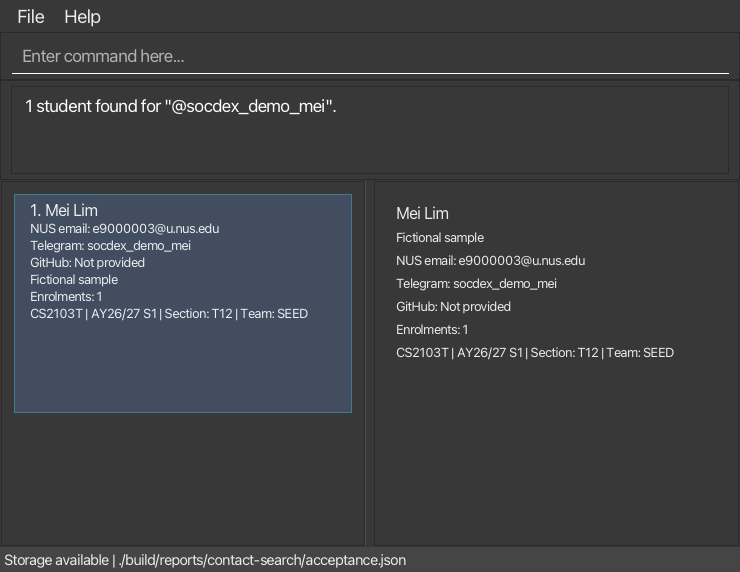

# SoCdex

SoCdex is a desktop roster manager for NUS School of Computing tutors who manage students across multiple tutorial sections and project teams in project-based modules.

Tutors often need to compare information from Canvas, spreadsheets, technical platforms, and personal records before they can identify or contact a student. SoCdex connects each student's identity, contact routes, module-semester enrolments, tutorial sections, and project teams in one local application.

## Why SoCdex?

SoCdex provides a keyboard-first workflow for tutors who prefer typed commands. A tutor can identify the correct student, check the relevant module and group context, and obtain a reliable contact route without switching between several sources. The application stores its roster data locally and does not require a remote server.

## Core capabilities

SoCdex supports the following capabilities:

* Create student profiles with names, NUS email addresses, and optional Telegram and GitHub usernames.
* Edit student names, NUS email addresses, and optional Telegram and GitHub contact details.
* Record module-semester enrolments with optional tutorial sections and project teams.
* Edit or clear tutorial sections and project teams for existing enrolments.
* Find students by name, NUS email, Telegram username, or GitHub username.
* View a student's complete profile and enrolments.
* Load and remove fictional sample data for product exploration.
* Preview a student record and confirm its deletion by NUS email.

SoCdex does not manage grades, attendance, submissions, schedules, disciplinary records, or teaching materials. It does not replace Canvas or other learning management systems.

## Documentation

* [User Guide](https://ay2627s1-cs2103t-w09-2.github.io/tp/UserGuide.html)
* [Developer Guide](https://ay2627s1-cs2103t-w09-2.github.io/tp/DeveloperGuide.html)
* [About Us](https://ay2627s1-cs2103t-w09-2.github.io/tp/AboutUs.html)
* [Releases](https://github.com/AY2627S1-CS2103T-W09-2/tp/releases)
* [Project repository](https://github.com/AY2627S1-CS2103T-W09-2/tp)

## Acknowledgements

SoCdex is based on the [AddressBook-Level3 project](https://se-education.org/addressbook-level3/) created by the [SE-EDU initiative](https://se-education.org/).
