* Table of Contents
{:toc}

--------------------------------------------------------------------------------------------------------------------

## **Acknowledgements**

* SoCdex is based on [AddressBook-Level3](https://se-education.org/addressbook-level3/) by the [SE-EDU initiative](https://se-education.org/).
* The graphical interface uses [OpenJFX](https://openjfx.io/).
* JSON storage uses the [Jackson](https://github.com/FasterXML/jackson) libraries.
* Automated checks use [JUnit 5](https://junit.org/junit5/), [JaCoCo](https://www.jacoco.org/jacoco/), and [Checkstyle](https://checkstyle.org/).
* The build uses [Gradle](https://gradle.org/) and the [Shadow plugin](https://gradleup.com/shadow/).
* Xie Kaiwen used OpenAI Codex to assist with implementation, tests, documentation, code review, and repository
  workflows. Xie Kaiwen remains responsible for these contributions.
* Spencer Chu used OpenAI Codex extensively to assist with implementation, tests, documentation, review, and
  repository workflows. Spencer reviewed and validated the accepted work and remains responsible for it.
* Le Minh Hoang made widespread use of Claude Code (Anthropic) for code and test generation, documentation and
  verification, and ChatGPT (OpenAI) for planning, technical review and drafting. He reviewed plans, code and
  diffs and remains responsible for his contributions.
* Jingchun Zhou used OpenAI Codex to assist with implementation, tests, documentation, code review, and repository
  workflows. Jingchun reviewed and validated the accepted work and remains responsible for it.
* Yujie Wang used Claude Code (Anthropic) extensively to assist with implementation, tests, documentation, code
  review, test evidence and repository workflows. Yujie reviewed and validated the accepted work and remains
  responsible for it.

--------------------------------------------------------------------------------------------------------------------

## **Setting up, getting started**

Refer to the guide [_Setting up and getting started_](SettingUp.md).

--------------------------------------------------------------------------------------------------------------------

## **Design**

<div markdown="span" class="alert alert-primary">

:bulb: **Tip:** The `.puml` files used to create diagrams are in `docs/diagrams`. Refer to the [_PlantUML Tutorial_ at se-edu/guides](https://se-education.org/guides/tutorials/plantUml.html) to learn how to create and edit diagrams.
</div>

### Architecture


The ***Architecture Diagram*** given above explains the high-level design of the App.

The following provides a quick overview of the main components and their interactions.

**Main components of the architecture**

**`Main`** (consisting of classes [`Main`](https://github.com/AY2627S1-CS2103T-W09-2/tp/blob/master/src/main/java/seedu/address/Main.java) and [`MainApp`](https://github.com/AY2627S1-CS2103T-W09-2/tp/blob/master/src/main/java/seedu/address/MainApp.java)) is in charge of the app launch and shut down.
* At app launch, it initializes the other components in the correct sequence, and connects them up with each other.
* At shut down, it shuts down the other components and invokes cleanup methods where necessary.

The bulk of the app's work is done by the following four components:

* [**`UI`**](#ui-component): The UI of the App.
* [**`Logic`**](#logic-component): The command executor.
* [**`Model`**](#model-component): Holds the data of the App in memory.
* [**`Storage`**](#storage-component): Reads data from, and writes data to, the hard disk.

[**`Commons`**](#common-classes) represents a collection of classes used by multiple other components.

**How the architecture components interact with each other**

The *Sequence Diagram* below shows how the components interact with each other for the scenario where the user confirms a deletion with `confirm-delete e9000001@u.nus.edu`, after a successful `delete e9000001@u.nus.edu` preview. `Logic` consumes the pending target, removes the student and asks the `UI` to present the result before `Storage` saves the roster. The successful result is returned only after the save.

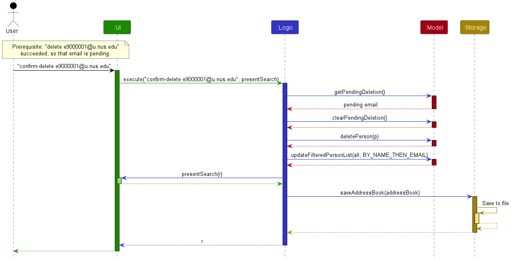

Each of the four main components (also shown in the diagram above),

* defines its *API* in an `interface` with the same name as the Component.
* provides its functionality through a concrete `{Component Name}Manager` class that implements the corresponding API interface.

For example, the `Logic` component defines its API in `Logic.java` and implements it in `LogicManager.java`. Other components interact with a component through its interface rather than its concrete class, preventing them from coupling to that component's implementation, as illustrated in the following partial class diagram.


The sections below give more details of each component.

### UI component

The **API** of this component is specified in [`Ui.java`](https://github.com/AY2627S1-CS2103T-W09-2/tp/blob/master/src/main/java/seedu/address/ui/Ui.java)

[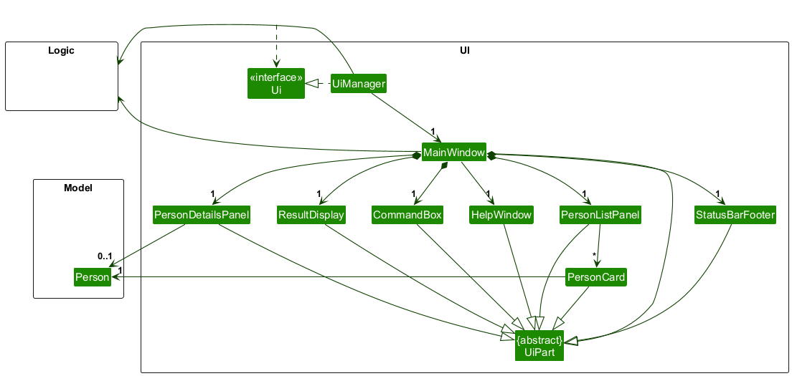](images/UiClassDiagram.png)

The UI consists of a `MainWindow` and its parts, such as `CommandBox`, `ResultDisplay`, `PersonListPanel`, `PersonDetailsPanel`, and `StatusBarFooter`. All of these, including `MainWindow`, inherit from the abstract `UiPart` class, which captures common behavior among classes that represent visible GUI parts.

The `UI` component uses the JavaFX UI framework. Most UI parts define their layouts in matching `.fxml` files in `src/main/resources/view`. `PersonCard` is the exception: it builds its layout in code (see [Measuring search responsiveness](#measuring-search-responsiveness)). For example, [`MainWindow.fxml`](https://github.com/AY2627S1-CS2103T-W09-2/tp/blob/master/src/main/resources/view/MainWindow.fxml) specifies the layout of [`MainWindow`](https://github.com/AY2627S1-CS2103T-W09-2/tp/blob/master/src/main/java/seedu/address/ui/MainWindow.java).

The `UI` component,

* executes user commands using the `Logic` component.
* listens for changes to `Model` data so that the UI can be updated with the modified data.
* keeps a reference to the `Logic` component, because the `UI` relies on the `Logic` to execute commands.
* depends on some classes in the `Model` component because it displays `Person` objects from the model.

A JavaFX `TextField` silently removes every character below U+0020, including tabs and line breaks, and DEL (U+007F) from inserted text, so a pasted `sample<TAB>load` would become `sampleload` and two pasted lines would run together into another command. `CommandBox` therefore installs a `TextFormatter` backed by `ControlCharacterMarkers`. It shows each tab as a space, each LF, CR or CRLF as one `↵` and any other character below U+0020, or DEL, as one `�`, and records where it inserted each marker. Other control and separator characters, such as U+0085 and U+2028, are neither removed nor marked: they stay in the field as pasted, and `ParserUtil.requireSingleLine` rejects the command with the same single-line message. On Enter, only the recorded markers become line breaks again, so `AddressBookParser` rejects the command with the single-line message while the same symbols typed as text stay text. Edits move the recorded positions with the text. A change that bypasses the formatter, such as an undo that restores a deleted marker, counts any marker symbol it restores as a control character, so the command is rejected rather than silently changed. `ControlCharacterMarkersTest` covers the conversions, the position tracking and the parser outcome.

### Logic component

**API** : [`Logic.java`](https://github.com/AY2627S1-CS2103T-W09-2/tp/blob/master/src/main/java/seedu/address/logic/Logic.java)

Here's a (partial) class diagram of the `Logic` component:


The sequence diagram below illustrates the interactions within the `Logic` component, taking the deletion preview `execute("delete e9000001@u.nus.edu", ...)` as an example. `DeleteCommand` finds the student by canonical email in the complete roster, records the pending target and returns a result that selects the student. The preview removes no data, so `LogicManager` does not save.


<div markdown="span" class="alert alert-info">:information_source: **Note:** The lifeline for `DeleteCommandParser` should end at the destroy marker (X), but due to a limitation of PlantUML, it continues to the end of the diagram.
</div>

How the `Logic` component works:

1. When `Logic` is called upon to execute a command, the command is passed to an `AddressBookParser` object, which in turn creates a parser that matches the command (e.g., `DeleteCommandParser`) and uses it to parse the command.
1. This results in a `Command` object (more precisely, an object of one of its subclasses e.g., `DeleteCommand`) which is executed by the `LogicManager`.
1. The command can communicate with the `Model` when it is executed (e.g. to record a pending deletion).<br>
   Note that although this is shown as a single step in the diagram above for simplicity, the code can require several interactions between the command object and the `Model` to complete the operation.
1. The result of the command execution is encapsulated as a `CommandResult` object which is returned from `Logic`.

Here are the other classes in `Logic` (omitted from the class diagram above) that are used for parsing a user command:

<a href="images/ParserClasses.png">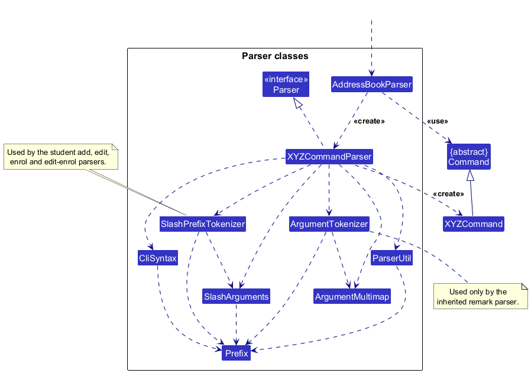</a>

How the parsing works:
* When called upon to parse a user command, the `AddressBookParser` class creates an `XYZCommandParser` (`XYZ` is a placeholder for the specific command name, e.g., `AddCommandParser`). The parser uses the other classes shown above to parse the user command and create an `XYZCommand` object (e.g., `AddCommand`). The `AddressBookParser` returns that object as a `Command` object.
* Parsers with slash prefixes (`student add`, `edit`, `enrol` and `edit-enrol`) tokenize with `SlashPrefixTokenizer`, which returns `SlashArguments`. The inherited `remark` parser still uses `ArgumentTokenizer` and `ArgumentMultimap`. The `delete`, `confirm-delete`, `view` and `find` parsers use only `ParserUtil`.
* `AddressBookParser` builds the parameterless commands (`list`, `help`, `bye`/`exit` and the retired `clear`) and `sample load`/`sample clear` itself, without an `XYZCommandParser`.
* All `XYZCommandParser` classes, such as `AddCommandParser` and `DeleteCommandParser`, implement the `Parser` interface so they can be treated similarly where appropriate, for example during testing.

### Model component
**API** : [`Model.java`](https://github.com/AY2627S1-CS2103T-W09-2/tp/blob/master/src/main/java/seedu/address/model/Model.java)

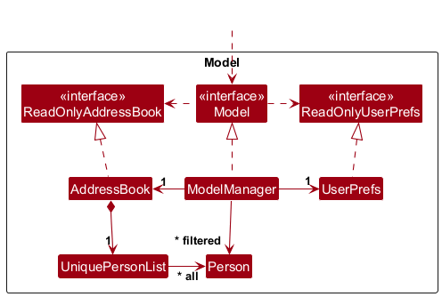


The `Model` component,

* stores the address book data i.e., all `Person` objects (which are contained in a `UniquePersonList` object).
* identifies each `Person` by its canonical NUS email: `Person#isSamePerson(Person)` compares only the `Email` values, so `UniquePersonList` accepts persons with equal names but rejects a second person with the same email. `Person#equals(Object)` and `Person#hashCode()` still compare every stored field, so a change to any saved field remains detectable.
* stores the `Person` objects selected by the current filter, such as search results, in a separate _filtered_ list, which a sorted view orders with the comparator supplied by the latest command. It exposes this view as an unmodifiable `ObservableList<Person>` that the UI can observe and bind to, so the UI updates when the list changes.
* stores a `UserPrefs` object that represents the user’s preferences (currently, just the GUI settings). This is exposed to the outside as a `ReadOnlyUserPrefs` object.
* does not depend on any of the other three components (as the `Model` represents data entities of the domain, they should make sense on their own without depending on other components)

The diagram above shows each `Person` as a single box. The class diagram below shows the values that make up a student profile at commit `33543cab`. It omits the remark and tags, and the members of the value classes.

<a href="images/StudentProfileClassDiagram.png">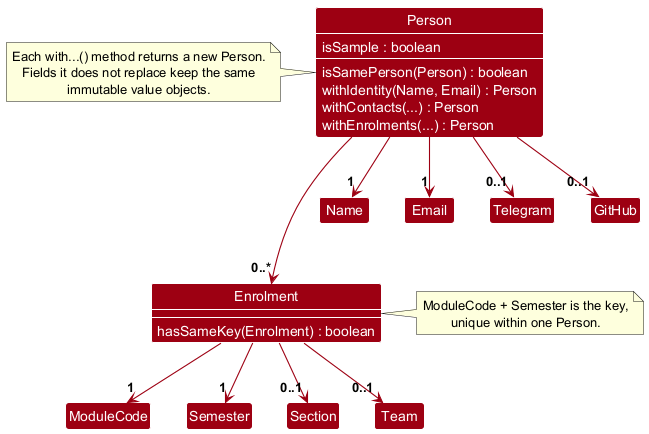</a>

* Enrolments are stored per profile: each `Person` holds a list of `Enrolment` values. The `Person` constructor rejects two enrolments with the same module and semester (`Enrolment#hasSameKey`), so each key is unique within one profile. An `Enrolment` has no reference back to its `Person`.
* `Person` and its values are immutable, so an edit creates a replacement `Person` and passes it to `Model#setPerson`. `withIdentity` and `withContacts` (both used by `edit`) and `withEnrolments` (used by `enrol` and `edit-enrol`) pass the current objects of every other field to the full constructor. The constructor copies the tag set and the enrolment list but keeps their elements, so unchanged fields keep the same value objects. `edit-enrol` creates a new `Enrolment` only for the edited entry. `RemarkCommand` also passes every other current field to the full constructor.
* `EditCommand` compares the old and new `Person`, and `EditEnrolCommand` the old and new `Enrolment`, using `equals` rather than object identity. If they are equal, the command does not call `setPerson` and reports `No values changed.`

### Storage component

**API** : [`Storage.java`](https://github.com/AY2627S1-CS2103T-W09-2/tp/blob/master/src/main/java/seedu/address/storage/Storage.java)

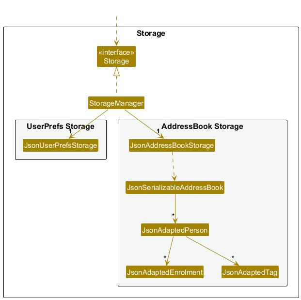

The `Storage` component,
* can save both address book data and user preference data in JSON format, and read them back into corresponding objects.
* is implemented by `StorageManager`, which delegates the actual JSON file access to `JsonAddressBookStorage` and `JsonUserPrefsStorage` (one class per data file).
* depends on some classes in the `Model` component (because the `Storage` component's job is to save/retrieve objects that belong to the `Model`)

### Persistence, rollback and protected loading

The following sequence summarises roster persistence at source commit
`24f0107eef57387d22d99ec06e9610166352303a`. `StorageManager` delegates both roster calls and is omitted
from the lifelines to keep the diagram readable. See [Storage safety](#storage-safety-v12) for the transaction
and recovery contract.

[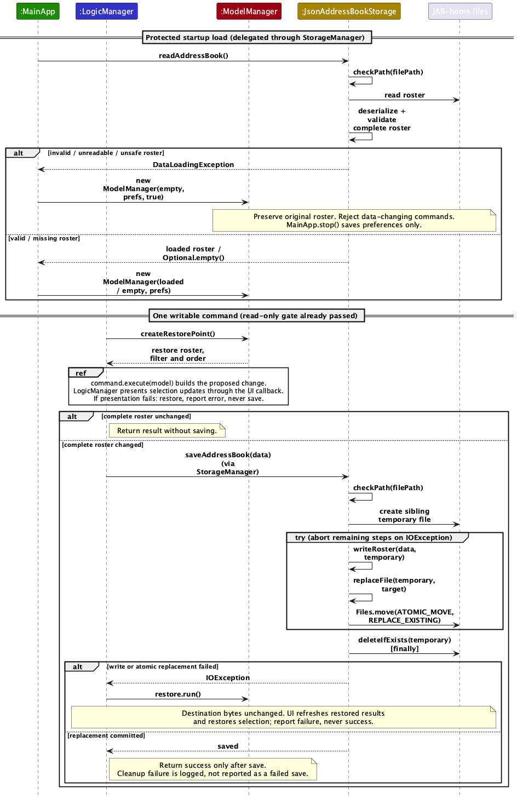](images/PersistenceRecoverySequence.png)

A missing roster starts an empty writable model. An invalid, unreadable or redirected roster raises
`DataLoadingException` and starts read-only recovery while preserving the original file. `MainApp.stop()` saves
preferences, not the roster. Production paths are checked against the physical JAR home before access.

For every command that passes the read-only gate, `LogicManager` captures the roster and display restore point,
executes the command and prepares any selection update before attempting a save. A presentation failure
restores the model and never writes; complete no-ops and deletion previews do not write either. Changed data is
serialized to a sibling temporary file and committed only through `ATOMIC_MOVE` with `REPLACE_EXISTING`. A write
or replacement failure restores the roster, filter and comparator; the UI executor then refreshes the restored
results, and `MainWindow` restores the previous selection and scrolls it into view. Temporary cleanup runs in
`finally`; a cleanup error after a committed replacement is logged and must not turn a successful save into a
reported failure. The illustrated save-failure branch covers temporary serialization and atomic replacement.
Path-check and storage-setup failures also restore the model, but temporary cleanup applies only after the
temporary file has been created.

The command/presentation reference describes the shared transaction mechanism that editing commands reuse.

### Common classes

Classes used by multiple components are in the `seedu.address.commons` package.

--------------------------------------------------------------------------------------------------------------------

## **Implementation**

This section describes some noteworthy details on how certain features are implemented.

### Enrolment storage (v1.2)

Each `Person` owns an immutable list of `Enrolment` values. `getEnrolments()` returns that list in stored order. `withEnrolments(Collection<Enrolment>)` returns a new profile, preserving all existing identity, contact, remark, and tag fields. The extended `Person` constructor and `PersonBuilder.withEnrolments(...)` support fixtures and dependent features. `Person` has a complete constructor taking name, email, optional Telegram, optional GitHub, sample classification, remark, tags, and enrolments. Its short creation constructor supplies `sample=false`, an empty remark, and empty tags/enrolments. Phone and address are removed. `withIdentity`, `withContacts` and `withEnrolments` replace only their named fields; `RemarkCommand` and the test copy builder preserve every other field. Sample loaders must use the full constructor with an explicit classification.

An enrolment contains `ModuleCode`, `Semester`, `Optional<Section>`, and `Optional<Team>`. Missing affiliations are `Optional.empty()`, never the UI label `Not assigned`. Module codes accept 2 to 4 ASCII letters, four ASCII digits, and up to 3 final ASCII letters, and are stored uppercase. Semesters accept `AYyy/yy S1` or `AYyy/yy S2` with consecutive years interpreted within 2000–2099; they are stored uppercase with a single separator space. Section and team labels allow 1 to 30 ASCII letters, digits, spaces, or hyphens, including at least one letter or digit. They preserve case. Input normalisation trims spaces/tabs and collapses their internal runs for semesters and affiliation labels; line breaks and other unsupported characters remain invalid.

`Enrolment.hasSameKey` compares module and semester only. `Person` rejects repeated keys even if their affiliations differ. Different students may own identical enrolments. Full enrolment and profile equality/hash codes include every enrolment field, so affiliation changes remain detectable by persistence. `Enrolment.DISPLAY_ORDER` sorts by academic start year, semester number, and module code for the profile-view feature; storage retains list order.

`JsonAdaptedEnrolment` stores a human-editable object inside each profile:

```json
"enrolments": [
  {"module": "CS2103T", "semester": "AY26/27 S1", "section": "T12", "team": "SEED"},
  {"module": "CS2113T", "semester": "AY26/27 S2", "section": null, "team": null}
]
```

Otherwise valid older profiles with no `enrolments` property load with an empty list. An explicit empty array also means no enrolments; an explicit null array, null item, malformed item, missing module/semester, invalid value, or repeated key rejects the entire load. Omitted or null `section` and `team` mean absence; empty strings are invalid. Stored strings must already equal the validated value's canonical form. Loading does not silently correct lowercase modules, semester spacing, or affiliation whitespace. Equivalent JSON escapes decode to the same valid string.

This increment adds model and persistence support. The user-facing `enrol` command is implemented by `EnrolCommand`; complete enrolment display was delivered by #65 (see [Profile viewing (v1.3)](#profile-viewing-v13)). The #58 storage contract protects rejected enrolment files and restores complete enrolments after failed saves. The integrated #59 identity rule allows same-name students with distinct canonical emails; storage still rejects non-canonical stored emails alongside enrolment validation. This schema's legacy compatibility does not override those features' email or sample-classification requirements.

### Editing enrolment affiliations (v1.4)

`EditEnrolCommandParser` reuses `SlashPrefixTokenizer` and the validated enrolment values. It checks structural
errors left to right before email, module, semester, section and team. Nested optionals distinguish omission
(preserve), `clear` (remove), and a replacement label. All selectors and at least one change field are required.

`EditEnrolCommand` resolves the owner against the complete roster and matches the immutable module-semester key.
It constructs one new `Enrolment`, replaces only that list entry and calls `Person.withEnrolments`, preserving all
other fields and sample classification. The full sorted roster and updated owner are presented through
`CommandResult.forTarget`. Normalised equality returns `No values changed.` without setting a new person;
case-preserving label changes remain distinct. LogicManager's transaction compares complete roster values,
presents before saving and restores roster/filter/order on failure. Both save and display failures use the
specified record-update error. Recovery gating and pending-deletion cancellation use the existing logic flow.
No JSON schema or shared presentation interface changes are needed.

`EditEnrolCommandParserTest` verifies structural/value precedence, semester slashes, normalisation, clearing and
literal `Clear`. `EditEnrolWorkflowTest` uses real JSON storage to verify exact ownership, field preservation,
no writes on no-ops, case-only changes, reload, recovery, failed atomic replacement and failed presentation.
For opt-in programmatic real-window acceptance, build `./gradlew testClasses shadowJar`, copy the JAR into a
new disposable folder, and run the phases as distinct JVMs from another disposable working directory:

```text
java -cp /ABS/CHECKOUT/build/classes/java/test:/ABS/JAR-HOME/addressbook.jar seedu.address.ui.EditEnrolAcceptance seed
java -cp /ABS/CHECKOUT/build/classes/java/test:/ABS/JAR-HOME/addressbook.jar seedu.address.ui.EditEnrolAcceptance restart
```

Quote classpaths containing spaces; Windows uses `;` instead of `:`. The driver invokes production `Main.main`,
submits through the real command box and exits through the window. It checks hidden-owner reveal, exact feedback,
invalid-input atomicity, no-op bytes, case-only updates, sample preservation, selected profile and persisted reload.
This is programmatic UI evidence with a real JVM restart, not manual keyboard testing. Record the source and JAR
checksum separately. Published-guide verification for this feature was tracked as a post-merge task in #96.

### Enrolment entry (v1.3)

`EnrolCommandParser` reuses `SlashPrefixTokenizer` and `SlashArguments`. Structural errors are checked first from left to right; values are constructed in email/module/semester/section/team order with the shared value types. Omitted affiliations are absent optionals. `AY26/27` stays within a value because its slash is not at a prefix boundary.

`EnrolCommand` resolves the canonical email against the complete roster, checks `Enrolment.hasSameKey`, copies the existing enrolment list and calls `Person.withEnrolments`. It preserves contacts, sample classification, tags, remark and every other profile. A successful result uses `CommandResult.forTarget` with the updated owner and the saved context in feedback, allowing #64 to run independently of #65. It applies `PersonOrder.BY_NAME_THEN_EMAIL` and clears the filter. Existing logic prepares presentation before persistence, rolls back failures, and returns success only after the save. Failed input/target/duplicate checks do not request presentation or persistence.

`EnrolWorkflowTest` exercises actual parsing, selection requests, complete JSON reload, same-name owners, classified samples, multiple contexts, duplicate normalisation, save/presentation failure and read-only recovery. `EnrolCommandParserTest` covers prefix combinations, ordering, missing/blank values, structural precedence and field constraints.

For opt-in real-window acceptance using fictional data, build with `./gradlew testClasses shadowJar`, then run:

```text
java -cp build/classes/java/test:build/libs/addressbook.jar seedu.address.ui.EnrolmentAcceptance
```

On Windows use `;` instead of `:` in the classpath. The utility drives the actual command box and records results, selection, rollback, saved bytes and a fresh model/window reload. It writes files and a screenshot under `build/reports/enrolment`. This is programmatic UI evidence, not manual keyboard entry or a process restart. Record the tested commit and actual runtime separately. `edit-enrol` now updates affiliations on an existing context (see [Editing enrolment affiliations](#editing-enrolment-affiliations-v14)).

### Application data sandbox (v1.3 release requirement)

[Constraint-Data-Sandbox](https://nus-cs2103-ay2627-s1.github.io/website/admin/tp-constraints.html#constraint-data-sandbox) confines application file access to the folder containing the running JAR and its subfolders. This is a release gate. For v1.3, packaged-runtime acceptance was recorded in #79 and #80. Current candidates follow the build, acceptance and publication handoff #135 → #142 → #143 recorded in #131, with build steps in [DevOps](DevOps.md).

`AppPaths` derives home from its production class's protection-domain code-source URI, decodes spaces/Unicode, and resolves the physical code location. Packaged execution uses the containing JAR directory; development execution from unpacked classes uses that classes directory as home. It never uses `user.dir` or an external working-directory fallback. A JAR launched through a symbolic link uses the physical JAR's folder. Home discovery failure stops startup.

`MainApp` supplies absolute home-relative preferences and roster paths and the home boundary to both JSON storage implementations. Production storage checks every read/write, including overloads, for normalised path escapes and symbolic-link components. Fixture constructors retain explicit test paths. Invalid/unreadable roster paths retain the existing read-only recovery contract; failed saves retain rollback. Preferences failures retain defaults and report write failures.

`LogsCenter` uses `home/logs`, checks existing redirected entries, and escapes literal percent characters before constructing `FileHandler` patterns. Rotation and lock files remain there. If file logging is unavailable, the already-initialised console logger reports the failure without using another file location. Before JavaFX startup, `Main` configures process-local `javafx.cachedir` and `java.io.tmpdir` under home and validates/prepares those directories. This changes no OS configuration. Unsafe/unwritable runtime directories stop startup rather than permitting JavaFX's external-cache fallback. Atomic roster temporary files already use the roster's parent directory.

Verification must use a packaged JAR and an unrelated working directory containing sentinel preferences and roster files. Confirm the production entry point ignores those files, creates logs/preferences/roster/runtime directories inside JAR home, persists and reloads a fictional teaching context across JVM restart, and leaves the external directory tree and bytes unchanged. `DataSandboxAcceptance` is an opt-in observer of the actual `Main.main` production window and command box; run `seed` and `restart` in separate processes. Redirect acceptance logs inside the JAR folder. It is programmatic UI input, not manual keyboard testing. Also launch directly using `java -jar` from the external folder and record the Java/runtime and artifact source. Test paths with spaces, Unicode and percent signs and rejected symbolic-link redirects. Existing external data is never automatically imported.

#### Linux rendering default

Traced WSL2/WSLg runs attributed Mesa shader-cache access under `~/.cache/mesa_shader_cache` to the SoCdex JVM's `QuantumRenderer` thread while JavaFX initialised its OpenGL ES2 pipeline. After configuring runtime directories and before `Application.launch`, `Main` calls `RenderingDefaults.configurePipeline()`. When `os.name` starts with `Linux` (the bundled JavaFX's own check), it sets the system property `prism.order` to `sw` unless the property is already set. Windows and macOS keep JavaFX's defaults. The property is process-local: no environment variable, OS or desktop setting changes, and the JVM is not relaunched.

`prism.order` is an implementation-specific JavaFX setting, not a public API. For the bundled JavaFX 17.0.7, `PrismSettings` reads it from the system properties once during static initialisation, uses an explicit comma-separated value as the pipeline order, and otherwise tries `es2,sw` on Linux. Recheck this after any JavaFX upgrade. Confirm the selected pipeline from runtime evidence (for example `libprism_sw.so` mapped and `libprism_es2.so` absent), not from the property value alone.

Trade-off and open scope:

* The software pipeline renders on the CPU, so drawing may be slower; native-Linux responsiveness is not measured yet.
* An explicit `prism.order` (command line, `JAVA_TOOL_OPTIONS` or `JDK_JAVA_OPTIONS`) is preserved. An override that selects `es2` can use the Mesa cache again.
* The mitigation covers only the Mesa shader cache. HotSpot performance data (`/tmp/hsperfdata_<user>`) and the GTK/dconf runtime file (`/run/user/<uid>/dconf/user`) were still accessed. On 21 October 2026, the [teaching team confirmed](https://github.com/NUS-CS2103-AY2627-S1/forum/issues/684#issuecomment-6312549486) that the default JVM behaviours described in this investigation are exempt from the data-sandbox constraint. These default runtime accesses do not require redirection or suppression to satisfy that constraint.
* This clarification does not permit application-controlled reads or writes outside JAR home or changes to OS settings. It does not establish complete sandbox certification or platform coverage. Evidence so far is WSL2/WSLg only; native Linux is not verified.

### Storage safety (v1.2)

`MainApp.initModelManager` loads the whole roster before creating a writable model. A missing file produces an empty writable roster without creating sample records. A failed load produces an empty `ModelManager` with `isReadOnly()` fixed to `true` for that session. The initial recovery explanation and persistent status-bar warning distinguish this view from a genuinely empty saved roster. Recovery requires a valid file and a restart; no in-session switch enables writes.

The shared command contract is:

* `Command.isReadOnly()` defaults to `false`. Commands that only read data or change the visible filter override it to return `true`. The `find`, `view`, `list`, `help`, and `bye` (with its `exit` alias) commands do so. The retired `clear` command also returns `true`, so it passes the recovery gate and is rejected with its retirement message in every session. `sample load`, `sample clear`, and profile mutations retain the default, so the recovery gate applies before execution.
* Commands validate and change the model through `execute(Model)`; they must not save directly. `LogicManager` owns persistence and returns the successful `CommandResult` only after storage succeeds.
* `Model.createRestorePoint()` captures the immutable roster records, current filter, and display comparator and returns a restoration action. `LogicManager` restores them after an execution or save failure. A read-only command that changes records is rejected and rolled back. Full record equality detects no-op changes so they do not rewrite the file.
* `MainWindow` captures the selected profile before execution and restores it after a rejected command, after model restoration, then scrolls the restored row into view. A duplicate-student rejection is the exception: it reveals the existing profile instead. Success text is not displayed before `LogicManager` returns. Normal window close saves preferences only; it does not save the roster.

`createRestorePoint()` reuses the search display restore point so failed saves preserve both the result filter and comparator. The profile view from #65 preserves the same selection restoration contract for its complete detail view. Changes to profile equality must include every persisted field so no-op detection remains correct.

When presentation or storage fails after a command changes the model, `LogicManager` logs the failed transaction stage and the exception after restoring the previous state. Each warning uses a fixed message that names the rollback stage, without the command text, and attaches the exception.

`JsonAddressBookStorage` writes the complete candidate into a temporary file in the destination directory and closes it before an atomic replacement. Unsupported or failed atomic replacement is an error; there is no non-atomic fallback and the previous destination is not truncated first. Failed first saves leave no roster destination. Temporary-file cleanup is attempted on success and failure, and a cleanup error after a committed replacement is logged rather than reported as a failed save. Save attempts reject symbolic-link destinations and existing read-only files.

`JsonUtil` distinguishes a definitely missing path from a path whose existence cannot be established, and requires exactly one complete non-null JSON document. `FileUtil` reads strict UTF-8; malformed bytes are rejected instead of replaced with replacement characters. Trailing garbage or additional JSON roots are rejected rather than silently ignored. Malformed JSON, invalid records, duplicate identities, and invalid adapter values reject the complete load. No records are silently dropped. This increment retained the identity and schema rules of its time. The later load rules for NUS email identity, sample classification and enrolments are described in [NUS email identity](#nus-email-identity-v12), [Optional contacts and sample classification](#optional-contacts-and-sample-classification-v12) and [Enrolment storage](#enrolment-storage-v12).

Protection covers detected failures, not power loss or hardware faults. The app does not implement backups, cross-process locking, or concurrent external file-edit detection. Recovery and no-op tests use temporary files and injected failures. The UI acceptance check additionally verifies the persistent warning and selected-row restoration.

The startup guidance for an empty roster is `No students in the roster. Add a student or load fictional samples.` Samples are never created automatically.

### Identifier search (v1.3)

`FindCommandParser` treats the complete argument as one literal query. It rejects controls and line breaks before trimming spaces and tabs, changes internal tabs to spaces, and checks the 100-code-point limit. `AddressBookParser` also validates the original command before trimming so that trailing line breaks cannot disappear before validation.

`IdentifierContainsQueryPredicate` compares the query with names, canonical emails and present Telegram/GitHub values using `Locale.ROOT` lowercase and contiguous substring matching. It removes exactly one leading `@` for Telegram comparison only; an empty remaining Telegram query never matches. Other fields retain the original query, so `@` can still match email addresses. The comparisons are combined with OR, returning each profile once. Absent contacts are not converted to display labels. It does not split words, remove accents, search enrolments, or interpret prefixes, regular expressions, or wildcards.

`ModelManager` exposes a `SortedList` over its `FilteredList`. The comparator overload of `updateFilteredPersonList` filters the complete roster and sorts only the display by lowercase name, then lowercase email. Stored order and records remain unchanged. The single-argument overload clears the display comparator and shows matching records in stored order. `list` and `remark` explicitly pass `PersonOrder.BY_NAME_THEN_EMAIL`; `student add` reapplies it after adding the record. Index-based commands operate on the displayed list.

`MainWindow` displays a snapshot panel, so a pending search cannot change the previous results or selection. `LogicManager.execute` accepts a search-presentation callback and captures the current filter and comparator before execution. The callback constructs every result card in a detached panel, selects and scrolls to the sole result (or clears selection), and applies CSS/layout before replacing the previous panel. Virtualized cells reuse those prepared cards, including results initially off screen. Success feedback follows that replacement. A runtime or FXML-loading failure restores the previous model filter/order, retains the old panel, and reports the specified retry message through `CommandException`. Parse failures also leave the old panel in place; `MainWindow` restores its previous selection and scrolls it into view. The UI-side `DisplayedCommandExecutor` refreshes changed snapshots after both successful and failed commands, preserving any surviving selection. Before executing another command, it verifies that the snapshot still equals the model list in order and content. If a refresh previously failed, the next submission only refreshes the display and asks the tutor to check the indexes and resubmit; it never executes an index taken from stale rows. These callbacks can be regression-tested with real logic and storage without starting JavaFX. [Profile viewing (v1.3)](#profile-viewing-v13) extends this display with a complete profile panel.

The following activity diagram traces the `find` path through the display guard, parser, model filter and result-selection callback. It shows why ambiguous results clear the selection and why a failed replacement leaves the previous display intact. The diagram was checked against source commit `24f0107eef57387d22d99ec06e9610166352303a`; pending-deletion cancellation and unrelated commands are omitted to keep the search flow readable.

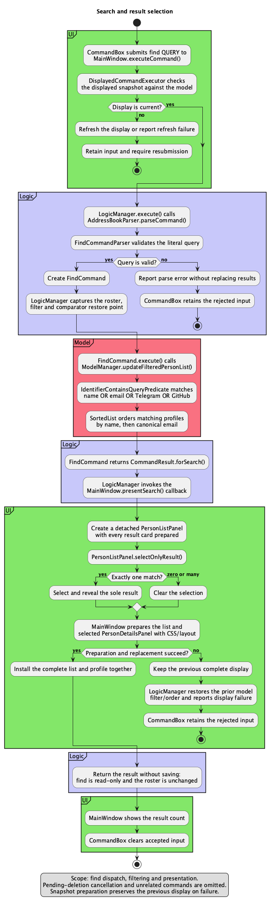

`FindCommand.isReadOnly()` returns true, so `LogicManager` skips persistence for successful searches, including zero matches. Other read-only commands and unchanged rosters also skip persistence. Data-changing commands use the storage recovery and atomic-save contract above.

Search does not change identity or field validation. Email identity allows profiles with identical names when their canonical emails differ. Names follow the Feature 3 rule: Unicode text is accepted, surrounding and repeated spaces and tabs are normalised, and the normalised name must contain 1 to 100 code points, include at least one visible character, and contain no forward slash, control character or malformed Unicode. Stored names are stricter: `JsonAdaptedPerson` validates each decoded stored name with the same rule and then requires it to equal the resulting `Name#fullName`, so a stored name with surrounding spaces or tabs, tabs between words or repeated spaces is rejected rather than corrected, and the whole load fails; `MainApp` then opens the read-only recovery session described in [Storage safety (v1.2)](#storage-safety-v12). Predicate and command tests cover independent same-name records, including an identical-name roster ordered by email.

Verification covers Telegram-only and GitHub-only matches, shared handles, multiple-field matches without duplicates, `@`/`@@` handling, absent contacts, literal phrases, partial emails, case and locale independence, whitespace, accents, punctuation, Unicode length boundaries, repeated searches, ordering, unchanged roster data, and the absence of save attempts. Manual acceptance additionally checks visible selection, error preservation, and a 500-profile timing measurement. The measurement is initial evidence and does not certify the reference-hardware NFR.

For a repeatable functional JavaFX check using fictional data, build with `./gradlew clean testClasses shadowJar`, then run the following from the repository root with a JavaFX-enabled JDK 25 (macOS/Linux classpath syntax):

```text
java -cp build/classes/java/test:build/libs/addressbook.jar seedu.address.ui.ContactSearchAcceptance
```

On Windows, replace the classpath separator `:` with `;`. This opt-in utility drives the real command box, checks selection and rendering-failure recovery, and refuses search save attempts. It writes fictional files and a screenshot under `build/reports/contact-search`. Its historical timing includes forced layout and a snapshot, after functional checks have already warmed the application. Keep that evidence for comparison, but do not describe it as a fresh-process ordinary-interaction measurement.

#### Measuring search responsiveness

Result cards are constructed directly from JavaFX controls to avoid parsing the same FXML document for every row. All cards and their complete text are still prepared before replacing the displayed list; construction failures retain the previous display. Matching, ordering and selection rules are unchanged.

The opt-in `PersonCardAcceptance` driver compares the card hierarchy, styles, dimensions and complete content against the previous FXML layout retained as a test fixture. After `./gradlew testClasses shadowJar`, run it with plain JDK 25:

```text
java --enable-native-access=ALL-UNNAMED -cp build/classes/java/test:build/resources/test:build/libs/addressbook.jar seedu.address.ui.PersonCardAcceptance
```

Windows uses `;` as the classpath separator. Also run `ContactSearchAcceptance` (including a failure while constructing the last result card), `MvpAcceptance` and `ProfileViewAcceptance` to check display rollback, selection, keyboard behaviour and profile presentation.

`SearchTimingProbe` was used for the v1.4 measurement handoff in #102 and remains the timing method for later candidates. It is a plain launcher that uses the JavaFX classes and native libraries in the candidate JAR. Use **plain JDK 25**, without a separately bundled JavaFX runtime, to measure the shipped JavaFX version. Build the driver and candidate with `./gradlew clean testClasses shadowJar`; record the source revision and JAR SHA-256. When testing a release candidate, replace `build/libs/addressbook.jar` below with the downloaded candidate and do not rebuild or modify it. The application classes must come from that JAR, not `build/classes/java/main`.

The probe checks that JavaFX base, graphics, controls and FXML classes come from the same candidate JAR. If a JDK bundles JavaFX or external JavaFX libraries override the candidate, it stops before opening the window or creating the output folder. Use plain JDK 25 and remove external JavaFX entries from the classpath or module path, then retry. This check applies even when an external library has the same version number as the candidate.

Create the parent output folder first. Each invocation requires a **new** child folder to avoid overwriting evidence. For example, on macOS/Linux:

```text
mkdir -p build/reports/search-timing
java --enable-native-access=ALL-UNNAMED -Dprobe.environment="CPU; RAM; storage; OS; reference mismatch" -cp build/classes/java/test:build/libs/addressbook.jar seedu.address.ui.SearchTimingProbe ordinary SOURCE_COMMIT build/reports/search-timing/ordinary-1
```

Replace `SOURCE_COMMIT` with the candidate's full source revision and describe the actual machine in `probe.environment`. Run this command in **three separate fresh processes**, changing the last argument to `ordinary-2` and `ordinary-3`. Do not run other acceptance drivers in those processes first or run timing processes concurrently. For comparison, repeat in three fresh processes with mode `snapshot` and new folders `snapshot-1` through `snapshot-3`. Windows uses `;` in the classpath and its normal folder-creation command.

The probe shows a 1280×720 window with 500 fictional profiles, each with two enrolments. After loading the roster and allowing two natural layout pulses, the **first search is `find bench`**, returning all 500 profiles. It records that search and five repeats, then six searches each for a unique Telegram match, a unique GitHub match and no match. Only the first full-roster search is cold with respect to command execution; later queries have already benefited from earlier queries. Startup, fixture creation and initial roster rendering are outside the one-second interaction target.

The timing starts immediately before firing the command box's action event:

| Field | Meaning |
| --- | --- |
| `command_ms` | Time until the real command handler returns, including filtering, prepared result cards, application-owned CSS/layout and feedback. |
| `ready_ms` | Time until the shown scene's next natural **post-layout pulse** after submission. This includes the command and normal scene layout; ordinary mode does not force CSS, layout or a snapshot. |
| `forced_css_ms`, `snapshot_ms` | Additional driver work in snapshot mode, reported separately. Both are zero in ordinary mode. Snapshot-mode `ready_ms` also includes this extra work and is diagnostic only. |
| `cards_ms` | Time inside `createPersonListPanel`, a subset of `command_ms`, not an additional duration. This includes preparing all result cards. |

A post-layout pulse is a **rendering-readiness proxy**, not proof that pixels have reached the physical display: JavaFX does not expose compositor completion here. The probe must not be reported as manual keyboard testing, a model-only benchmark, or exact end-to-end display latency. Keep native/manual observation in the final acceptance matrix. The printed focus, screen and scale values make programmatic-launch and display limitations explicit.

Every run writes `timings.csv` with source/JAR identity, runtime, environment and every observation. Verification outside the timing checks result counts, sorted order, unique/ambiguous selection, feedback and rendered result cells; any save attempt fails. Ordinary rows over **1,000 ms** are marked `MISS` rather than hidden or used to weaken the target. Snapshot rows are marked `DIAGNOSTIC`. For v1.4, misses and failures were reported to #94 and the scope decision was tracked in #98. For a later candidate, report every miss and failure in its acceptance issue (#142 for v1.5).

Run on the specified Intel Core i5-1035G1 / 8 GB / SSD / Windows 11 reference configuration, or explicitly record the mismatch. Development-machine results do not certify that configuration. The v1.3 timings are retained in #80 and the v1.4 candidate's logs in #102. Compare a later candidate honestly against them and attach its complete logs to its acceptance issue.

### Profile viewing (v1.3)

`ViewCommandParser` rejects line breaks, trims spaces and tabs, and counts tokens before validating the email. An empty argument gives the missing-email message and two or more tokens give the extra-argument message, so `view /email EMAIL` is reported as an extra argument rather than an invalid email. A single token is canonicalised by `ParserUtil.parseEmail`.

`ViewCommand` looks up the canonical email in the complete roster, not the displayed list, so hidden students can be viewed. If the target is already displayed, the filter and comparator are kept. Otherwise the command shows all students with `PersonOrder.BY_NAME_THEN_EMAIL`. It returns `CommandResult.forTarget`, and `isReadOnly()` is true, so `LogicManager` never saves and the command remains available during read-only recovery. `Command#getDisplayFailureMessage` lets the command replace the generic profile-display failure message with its own retry guidance. The rollback path is unchanged.

`MainWindow` places `PersonListPanel` and `PersonDetailsPanel` side by side in a `SplitPane`. The details panel follows the list selection. A sole `find` result, `view`, `student add`, `edit` and a revealed duplicate therefore all show the complete profile, and a cleared selection shows the selection prompt. For a command presentation, `prepareAndReplaceDisplay` builds both panels in detached scenes with the window stylesheets, applies CSS and layout, then swaps both placeholders. Inside the prepared panel, `PersonListPanel#selectOnlyResult` selects a sole search result and scrolls to it, and `PersonListPanel#selectTarget` does the same for an explicit target. For an explicit target only, `MainWindow` repeats the scroll once the panel is attached (`PersonListPanel#revealSelection`). An ambiguous or empty search clears the selection, and a `sample clear` refresh restores a surviving selection without scrolling. A panel moved out of its preparation scene keeps stale styles, so `MainWindow` applies CSS to the details panel again after the swap; the preparation pass still sizes and lays out the panel before it is shown. If either swap fails, both previous panels are restored before the error reaches `LogicManager`, so failed presentation never shows a new list with a stale profile. A selection made with the mouse or keyboard prepares a new details panel the same way. If that fails, the previous profile stays visible, the result display shows `Messages.MESSAGE_PROFILE_DISPLAY_FAILURE`, and the list selection is restored to the displayed profile.

The following sequence diagrams show how the selected student is chosen and how the complete profile is shown. Both were checked against source commit `33543cab24cc40fa95e2f32c7979e01cf220b3cf`. The first diagram was rechecked against `0a71ba778bfd1024454f2cf952086ea033612d1f` and now includes the conditional `revealSelection` step. The first diagram starts when `LogicManager` presents a command result. `DisplayedCommandExecutor`, parsing and command execution are omitted; see [Identifier search (v1.3)](#identifier-search-v13) for those steps and [Persistence, rollback and protected loading](#persistence-rollback-and-protected-loading) for the restore and save that follow.

[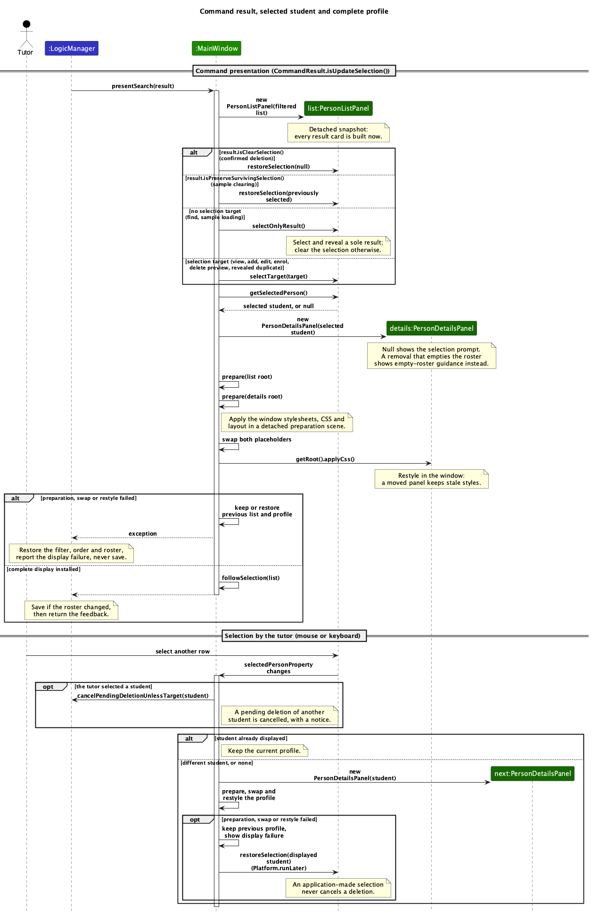](images/ProfilePresentationSequenceDiagram.png)

The second diagram shows a selection made by the tutor with the mouse or keyboard. Only the details panel is replaced, and no command result or save is involved.

[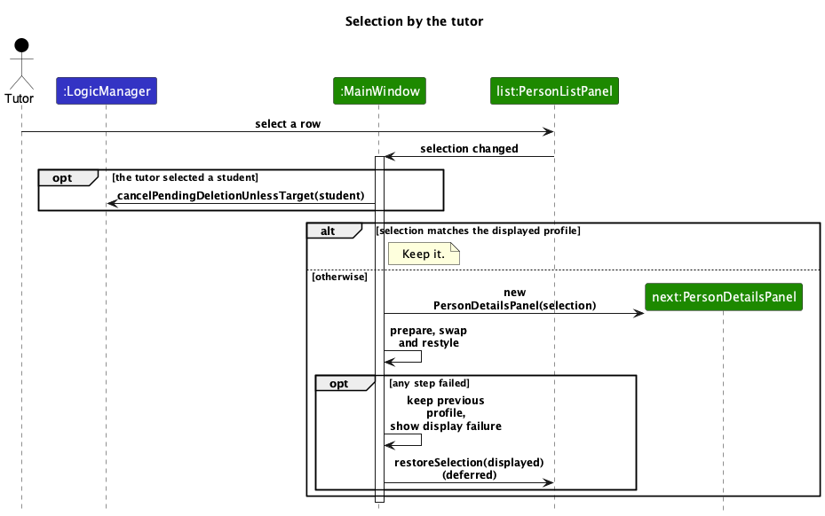](images/ProfileSelectionSequenceDiagram.png)

`PersonCard.enrolmentLine` and `PersonCard.enrolmentText` format enrolments in `Enrolment.DISPLAY_ORDER`, and `PersonDetailsPanel.profileLines` lists the profile fields in a fixed order, ending with `Remark: ` and the complete remark when there is one. Both are static and can be tested without starting JavaFX. The remark label on a result card and every profile line wrap, so a long remark is not cut off at narrow window widths. The stored remark text is shown unchanged. `Not provided`, `Not assigned` and `Enrolments: none` are display text only and are never stored.

For an opt-in layout check using fictional data, build with `./gradlew testClasses shadowJar`, then run:

```text
java -cp build/classes/java/test:build/libs/addressbook.jar seedu.address.ui.ProfileViewAcceptance
```

On Windows use `;` instead of `:` in the classpath. The utility lays out the real window content at 1920 × 1080, 1536 × 864 and 853 × 480 logical pixels, which are the usable sizes of 1920 × 1080 at 100% and 125% scaling and 1280 × 720 at 150% scaling. It views a student with a long name and email, both contacts and 12 enrolments. It checks that every profile and result-row label shows and exposes its complete text, that profile lines wrap within the panel, and that scrolling reaches the last enrolment. Before forcing any CSS pass, it checks after each command and key press that the profile heading has its theme style: white 16px text with no background. It also checks that Tab and Shift+Tab move between the command box and the result list, that the arrow keys change the selected profile, and that viewing never saves. `DarkTheme.css` outlines the result area and the result list while either has keyboard focus. The utility checks that this outline appears only in the focused state and does not change their size. The window is never shown, so the focused state is applied directly. Confirm manually that the outline follows Tab in the packaged application. Screenshots are written under `build/reports/profile-view`. The scaling is simulated by the logical size. Confirm OS display scaling and screen-reader output manually, and record the tested commit and actual runtime separately.

To check a long remark ([issue #191](https://github.com/AY2627S1-CS2103T-W09-2/tp/issues/191)), run:

```text
java -cp build/classes/java/test:build/libs/addressbook.jar seedu.address.ui.RemarkReadabilityAcceptance
```

At the default 740 × 600 and minimum 450 × 600 logical sizes, this utility adds two fictional students and saves a long remark ending in `END-OF-NOTE` with `remark 1 r/...`. It then runs `view EMAIL` and checks that the result card and the profile panel both draw and expose the complete remark, that the card's remark wraps, that the remark line needs no horizontal scrolling, and that scrolling the profile panel reaches it. It reads the saved file and checks that the remark is stored exactly as typed. It then loads that file in a new window and repeats the checks. Finally, `remark 2 r/...` must change only the second student, leaving the first student's other fields and the selection unchanged, so the displayed index still refers to the right student. Screenshots are written under `build/reports/remark-readability`. As with `ProfileViewAcceptance`, the window is never shown, so confirm the packaged window manually and record the tested commit and actual runtime separately. Loading the file again in a new window stands in for a restart of the same process; confirm a real restart of the packaged JAR manually.

Below the student list and profile panels come the result area, then the command box, then the status bar, so the latest result sits just above the next command. Tab follows the same order: from the command box it moves to the student list, then the result area, then back to the command box, and Shift+Tab reverses this. The result area wraps its text and is 160px tall, so the deletion preview's confirmation instruction is always in view without scrolling. Line height depends on the platform font. On macOS the whole six-line preview fits. On Windows it is taller than the area, so the final line, `Any other command will cancel this deletion.`, is reached by scrolling; a vertical scrollbar shows this. The status bar is an `HBox`: `Deletion pending` keeps its full width, and the data-file path wraps onto more lines instead of being cut off. The status bar is never shrunk below the height it needs. To check these at compact sizes, run:

```text
java -cp build/classes/java/test:build/libs/addressbook.jar seedu.address.ui.CompactFeedbackAcceptance
```

The utility lays out the real window content at the default 740 × 600, the minimum 450 × 600 and 853 × 480 logical pixels, using a data-file path long enough to wrap. It runs `sample load`, a deletion preview and a rejected `student add` whose email is too long. After each, it checks that the result needs no horizontal scrolling. It also checks that the preview's `Type: confirm-delete EMAIL` line is in view without scrolling, that `Deletion pending` and the path are not truncated, and that the status bar stays inside the window. After the preview and after the rejection, it checks that the command box has the 2px `#e2e2e2` outline only in the focused state, with no change in size. It also checks that the panels, result area, command box and status bar appear in that order from top to bottom, that a rejected command keeps its text and error style, and that each Tab and Shift+Tab press reaches the next region in that order. Screenshots are written under `build/reports/compact-feedback`. As with `ProfileViewAcceptance`, the window is never shown and the scaling is simulated, so confirm the packaged window manually.

### Confirmed deletion (v1.3)

`DeleteCommandParser` and `ConfirmDeleteCommandParser` share `ParserUtil.parseSoleEmail`, which applies the single-line check, trims spaces and tabs, and reports a missing email, then extra tokens, before validating the one remaining token with the NUS email rule. An index such as `1` therefore fails the email rule. Blank input reaches `AddressBookParser`, which reports `Messages.MESSAGE_ENTER_COMMAND`; `CommandBox` submits empty input too.

The pending target is session-only state in `ModelManager`: one canonical `Email`, set, read and cleared through `Model#setPendingDeletion`, `Model#getPendingDeletion` and `Model#clearPendingDeletion`. It is not part of `AddressBook`, so it is never saved, never compared by the no-op check, and never captured or restored by `Model#createRestorePoint()`. It survives only a fully successful preview. The UI reads and cancels it only through `Logic` (`hasPendingDeletion`, `cancelPendingDeletion` and `cancelPendingDeletionUnlessTarget`); it keeps no copy.

* `DeleteCommand` finds the target by canonical email in the complete roster, keeps the current results if the target is displayed and otherwise shows all students with `PersonOrder.BY_NAME_THEN_EMAIL`, records the pending target, and returns `CommandResult.forTarget` with the preview text. Its enrolment count comes from the stored record. It changes no roster data, so `LogicManager` does not save. `isReadOnly()` stays `false`, so read-only recovery rejects it.
* `ConfirmDeleteCommand#isDeletionConfirmation()` returns `true`. Execution reads and clears the pending target before any check, so every confirmation attempt consumes it. It then reports a missing target, a different email, or a target that no longer exists. Otherwise it removes the `Person`, whose enrolments are stored inside it, so one atomic save covers both. It shows all students with `PersonOrder.BY_NAME_THEN_EMAIL` and returns `CommandResult.forClearedSelection`. Both `getSaveFailureMessage` and `getDisplayFailureMessage` return the fresh-preview failure message.

`LogicManager#execute` applies the cancellation rule to every submission that reaches it. A parse failure, such as blank input or a malformed confirmation, clears the pending target and, if one existed, rethrows the `ParseException` with `Messages.MESSAGE_PENDING_DELETION_CANCELLED` on its own first line. Any other parsed command that is not a deletion confirmation clears the target before the recovery gate and execution. Its result gets the same first line through `CommandResult#withNotice`, which keeps every other field, including the help, exit and selection flags. Errors keep their exception type; a `DuplicateStudentException` keeps its revealed profile. Whenever execution fails, a `finally` block clears the target again, so a failed replacement preview leaves nothing pending.

`CommandResult.forClearedSelection` requests a selection update, so `LogicManager` presents it through the existing callback before saving. `MainWindow#presentSearch` prepares the full roster with no selection, even with one survivor, and shows the empty-roster guidance shared with `CommandResult.forSurvivingSelection` when no students remain. A presentation or save failure takes the existing restore path: the roster, filter and order are restored, and the destination file is unchanged because the atomic save never replaced it. The target was already consumed, so a fresh preview is required.

Submissions that never reach `LogicManager` also end the deletion:

* When the displayed list is stale, `DisplayedCommandExecutor` calls `Logic#cancelPendingDeletion()` before refreshing, even if the refresh then fails. It adds the cancellation line to its existing message and never runs or retries the rejected command.
* `MainWindow#handleExit` is the single exit path for `bye`/`exit`, the window's close request and **File > Exit**. It discards the pending target before recording GUI preferences. `MainApp#stop` saves preferences only, so closing never rewrites the roster or a file preserved by read-only recovery.
* After every submission, successful or not, `MainWindow` updates the `Deletion pending` text in `StatusBarFooter`.

Selecting a different student cancels the deletion only when the user made the selection. `PersonListPanel` runs its own selection changes (`restoreSelection`, `selectTarget` and `selectOnlyResult`) inside a guard that is restored in `finally`, and `isUserSelectionChange()` reports whether the guard is inactive. `MainWindow` ignores callbacks from panels that are no longer displayed. For a user selection of a non-null student, it calls `Logic#cancelPendingDeletionUnlessTarget`, which compares canonical emails, so selecting the target again, or a deselection, keeps the deletion pending. Preview selection, refresh, surviving-selection restoration, cleared-selection results and failure restoration are app-made and never cancel. If the newly selected profile cannot be displayed, the result shows the cancellation line above `Messages.MESSAGE_PROFILE_DISPLAY_FAILURE`. The deferred row restoration that follows is app-made, so it neither cancels again nor brings back the deletion.

`DeleteCommandTest`, `ConfirmDeleteCommandTest`, the parser tests and `DeletionWorkflowTest` cover these rules with real JSON storage and deterministic failures injected at the temporary-file write and the atomic replacement. `DisplayedCommandExecutorTest` covers stale-display cancellation without starting JavaFX. For an opt-in real-window check using fictional data, build with `./gradlew testClasses shadowJar`, then run:

```text
java -cp build/classes/java/test:build/libs/addressbook.jar seedu.address.ui.DeletionStatusAcceptance
```

On Windows use `;` instead of `:` in the classpath. The driver submits commands through the real command box and sends mouse and keyboard events through the list's own handlers. It also uses the window close request and the **File > Exit** menu item. It writes fictional files under `build/reports/deletion-status`. This is programmatic UI evidence, not manual or packaged-app acceptance; record the tested commit and runtime separately.

### No undo for confirmed deletion

SoCdex has no undo command, version history or recycle bin. A deletion that has been confirmed and saved is permanent. The preview and matching confirmation described in [Confirmed deletion (v1.3)](#confirmed-deletion-v13) are the safeguard against deleting the wrong student.

Rollback is different from undo. If a command fails before its change is saved, for example because saving or presenting the result fails, `LogicManager` restores the roster, filter and order captured by `Model#createRestorePoint()`, and the atomic save leaves the previous file in place. Rollback only reverses an operation that did not complete; it never reverses a deletion that was saved successfully.

### Integrated MVP acceptance (v1.3)

`MvpAcceptance` runs the MVP features as one sequence on one roster file, so each step starts from the state that the previous step saved. To verify the driver against a local build, run `./gradlew clean testClasses shadowJar`, then run:

```text
java -cp build/classes/java/test:build/libs/addressbook.jar seedu.address.ui.MvpAcceptance
```

On Windows use `;` instead of `:` in the classpath. This local run verifies the driver and the locally built code. It is not acceptance evidence for the release candidate.

For exact release acceptance, download the candidate JAR and verify its SHA-256 checksum against the release. Check out the candidate commit and run `./gradlew clean testClasses` to compile the matching driver. Run the command above with `build/libs/addressbook.jar` replaced by the path to the downloaded JAR. Do not put `build/classes/java/main` on the classpath. Record the candidate commit, checksum, runtime and hardware with the result.

Each session opens the file as `MainApp#initModelManager` does: empty if absent, read-only recovery if invalid. A restart in this driver is simulated. It creates a new window with a fresh model and logic on the saved file, not a new process. In order, the driver checks:

1. **First use:** the empty-roster guidance with no file created, then `sample load`. `find Alex Tan` shows both Alex Tan rows, each with its full email, contacts, sample label and enrolments, and makes no automatic choice. A unique Telegram match and `view` show the complete profile.
2. **A non-sample student:** `student add`, two `enrol` contexts, an optional-contact `edit`, then `find` by name, NUS email, Telegram and GitHub. After `bye` and a restart, the same records return.
3. **Deletion:** each cancellation class saves nothing. The classes are another command, blank input, an unknown command, a malformed or mismatched confirmation, a replacement preview, a stale display and keyboard selection of another student. Then a preview and a confirmed deletion.
4. **Selective removal:** `sample clear` with a search hiding the samples reports the actual counts removed and keeps the non-sample student selected. A repeated clear saves nothing, and a restart returns only the real record.
5. **Guards and no-ops:** duplicate email and enrolment guards, `sample load` into a non-empty roster, an invalid email and the retired `clear` command are rejected without a save. A no-op `edit` is not a rejection: it reports `No values changed.` and does not save.
6. **Pasted tabs and line breaks:** the driver inserts text at the caret with `TextInputControl#replaceSelection`, the method `TextInputControl#paste` calls after reading the clipboard; the system clipboard itself is not used. A pasted tab between `find` and `Priya` becomes a space and the search runs. A pasted LF, CRLF or vertical tab between two commands, each while a deletion is pending, stays visible as its marker. The command is rejected with `Enter one command on a single line.` after the cancellation notice, keeps its text, error style and focus, and deletes nothing. The corrected command then runs, and a typed `↵` is searched for as ordinary text.
7. **Injected failures:** save failures for `edit`, `enrol`, `student add` and `confirm-delete`, and display failures for `view`, `student add` and `find`. Each must keep every record, the file bytes, the displayed results, the selection and the complete profile. Once storage recovers, the same `edit` is saved; once the display recovers, the same `find` shows its result.
8. **Failed save with a distant selection:** in a 740 × 600 window, `view` selects a student near the end of the list, then an injected save failure for `student add` keeps the records and the file bytes, and the restored selected row stays visible.
9. **Invalid files:** truncated JSON and a file with an invalid stored email each open an empty read-only session. That session shows the preservation message and the recovery status, rejects five representative data-changing commands and still searches. Closing it by `bye` or by the window close request leaves the file bytes unchanged. After a valid file is restored, the next start loads its records normally.

Commands are submitted by setting the command box text and firing its action, and the list receives key events through its own handlers. This is programmatic UI evidence, not manual keyboard operation. At the selected rejection checkpoints, the driver checks that the rejected command stays in the command box with the error style and command-box focus. It also checks command-box focus after the success and profile-display checkpoints that call the shared focus assertions. Initial window focus depends on the OS, so the driver records it in the transcript rather than asserting it. The commands, results, assertion count and runtime are written to `build/reports/mvp-acceptance/transcript.txt`.

`MvpAcceptance` covers the in-window workflow only. Release acceptance also needs these, run against the same candidate JAR:

* `DataSandboxAcceptance` `seed` and `restart`, a real restart through the production entry point (see [Application data sandbox](#application-data-sandbox-v13-release-requirement)).
* `ProfileViewAcceptance` for the DG resolutions and scales, and the Tab and Shift+Tab focus order.
* `CompactFeedbackAcceptance` for feedback, the status bar, the command-box outline, the window layout order and the Tab order at compact sizes.
* `ContactSearchAcceptance` for search behaviour and `SearchTimingProbe` for separate ordinary-layout and snapshot timings over 500 profiles and 1,000 enrolments.
* `DeletionStatusAcceptance`, `SampleClearAcceptance` and `EnrolmentAcceptance` for the feature-level window checks.
* `EditEnrolAcceptance` `seed` and `restart` in separate processes (see [Editing enrolment affiliations](#editing-enrolment-affiliations-v14)).
* `PersonCardAcceptance` for the result-card layout (see [Measuring search responsiveness](#measuring-search-responsiveness)).
* `RemarkReadabilityAcceptance` for a long remark on the result card and in the profile panel.
* Manual keyboard testing on the reference platforms.

Start release builds from `clean`. Running tests or the application from the build directory can write logs under `build/classes/java/main`. `shadowJar` excludes the top-level `logs/` directory so a later non-clean rebuild does not package those stale files. `JarContentsTest` checks the exclusion and the required resources under the normal `check` workflow. The clean start still removes unrelated stale build output. It does not prove that separate checkouts or platforms produce a byte-identical JAR. For v1.3, build reproducibility was tracked separately in #79.

### NUS email identity (v1.2)

`Email` contains the single validation and canonicalisation rule used by both commands and storage. `Email#isValidEmail(String)` ignores only surrounding spaces and tabs and rejects any non-ASCII character before lowercasing, so a character such as the Kelvin sign cannot become an ASCII letter. It then lowercases the value with `Locale.ROOT` and requires a local part of 1 to 64 ASCII letters, ASCII digits, `.`, `_`, `+`, or `-` that starts and ends with an ASCII letter or digit and contains no consecutive dots, followed by exactly `@u.nus.edu`. The constructor stores this canonical value, so `Email#equals` and `Email#hashCode` compare canonical emails. Dots and plus suffixes remain significant, no aliases are inferred, and no network check is made: the rule is a local syntax check, not account verification.

`ParserUtil#parseEmail` delegates to `Email` instead of trimming the input itself, so command input may contain uppercase letters and surrounding spaces or tabs. Stored data is stricter. `JsonAdaptedPerson` validates each stored email with the same rule and then requires the decoded stored string to equal the resulting `Email#value`. A syntax-valid but non-canonical stored email, such as one with uppercase letters or surrounding spaces or tabs, is rejected instead of corrected, so the app never rewrites a stored identity automatically. `JsonSerializableAddressBook` also rejects a data file in which two records share a canonical email. Any rejected record makes the whole load fail; no record is skipped or partially imported. `MainApp` then opens the read-only recovery session described in [Storage safety (v1.2)](#storage-safety-v12), so the incompatible file is not overwritten.

Identity and equality are deliberately separate. `Person#isSamePerson` compares canonical emails and drives duplicate detection in `UniquePersonList`, `AddCommand`, and `EditCommand`, so students with equal names can coexist. `Person#equals` and `Person#hashCode` compare every stored field. Enrolments, contacts and sample classification also participate in `equals` and `hashCode`, so changes remain detectable.

**Design consideration:** names are not unique among students and are not a reliable key. A canonical NUS email gives each student one unambiguous key for lookup, editing, and duplicate checks. The cost is that data files from earlier versions with other email addresses are no longer valid; such files open in read-only recovery instead of being replaced. Requiring stored emails to be canonical keeps stored email values consistent with the form written by the app, at the cost of rejecting hand-edited emails that use uppercase letters or surrounding spaces or tabs.

### Optional contacts and sample classification (v1.2)

`Person` stores an `Optional<Telegram>`, an `Optional<GitHub>`, and a `boolean` sample classification. An absent contact is `Optional.empty()`, never display text such as `Not provided`. `Telegram` and `GitHub` remove surrounding spaces and tabs from input, and `Telegram` also removes one leading `@`. Both keep the letter case of the value and compare values case-sensitively. The literal word `clear` is an ordinary value. `Person#equals` and `Person#hashCode` include all three fields, so a contact change, a case-only contact change, or a classification change is a real change. `Person#isSamePerson` still compares only canonical emails.

`Person` has a complete constructor taking name, email, optional Telegram, optional GitHub, sample classification, remark, tags, and enrolments. The short creation constructor supplies `sample=false`, an empty remark, and empty tags/enrolments. `EditCommand` uses `Person#withIdentity` and `Person#withContacts`; `RemarkCommand`, `Person#withEnrolments`, and the test copy builder preserve every other field. `AddCommandParser` accepts optional contacts when creating a non-sample profile. `SampleDataUtil` uses the complete constructor with `sample=true`; it is not used at startup. Phone and address are no longer profile fields.

`JsonAdaptedPerson` stores the fields as follows:

```json
"telegram": "Alex_Tan",
"github": null,
"sample": false
```

`telegram` and `github` are optional; an omitted property or `null` means absence. `sample` is required and must be a JSON boolean. The adapter reads all three as Jackson `JsonNode` values through `@JsonSetter` methods, so text, numbers, arrays, and objects are rejected instead of being coerced. After name and email, `toModelType` checks the Telegram handle, then the GitHub username, then the classification. A stored contact must be a JSON string, must be valid, and must already equal its saved form (`Telegram#value` or `GitHub#value`). For example, a stored `"@alex_tan"` or `" alex_tan"` is rejected with `MESSAGE_NON_NORMALISED_CONTACT` instead of being corrected. Comparisons use the decoded string, so equivalent JSON escapes are accepted. A missing, `null`, or non-boolean `sample` is rejected. The writer always emits `sample` and writes `null` for an absent contact. Any rejection makes the whole load fail, and `MainApp` opens the read-only recovery session described in [Storage safety (v1.2)](#storage-safety-v12).

`PersonCard` shows a `Telegram:` line and a `GitHub:` line, using `Not provided` for absence. It also shows a `Fictional sample` label, which is visible and managed only when `Person#isSample()` is true.

`JsonAdaptedPerson` explicitly rejects the presence of retired `phone` and `address` properties (including null). This prevents Jackson from ignoring those properties and silently discarding legacy values. An otherwise valid profile without optional contacts still loads with absence; missing/non-boolean sample classification rejects loading. No migration or inferred classification runs automatically.

### Fictional sample loading and removal (v1.2 to v1.3)

`AddressBookParser` recognises the exact lowercase `sample load` and `sample clear` commands after removing surrounding spaces and tabs. Repeated spaces or tabs between the two words are accepted. Extra text after `load` or `clear` produces that subcommand's exact usage message. A missing, unsupported, or incorrectly cased subcommand produces `Usage: sample load | sample clear`. An uppercase root command such as `Sample` uses the normal unknown-command error. The shared single-line guard rejects line breaks and control characters before parsing.

The following activity diagram shows the validation, persistent sample classification and shared transaction flow at commit `e6c9bc58`. Both commands change the model only through the transaction managed by `LogicManager`. A command, presentation or save failure restores the previous roster, filter and display order.

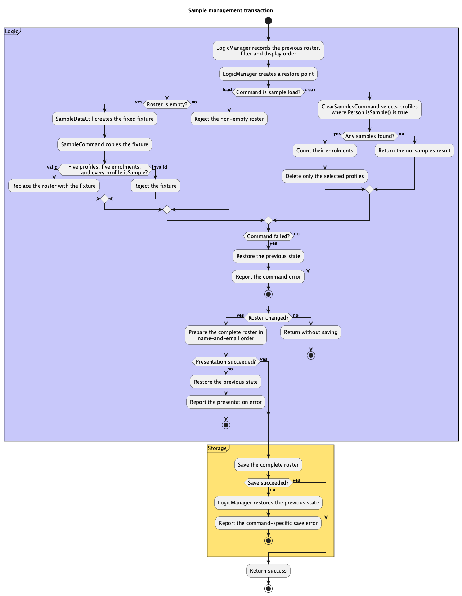

`SampleDataUtil` is the single production fixture provider. It returns five classified fictional profiles and five enrolments in name-and-email display order. The fixture covers equal names with distinct canonical emails, optional contacts, multiple enrolments, missing contacts, missing affiliations, and a profile with no enrolments. The application does not call this provider during startup.

`SampleCommand` first checks that the writable roster is empty. It then copies and validates the complete fixture before changing the model. Validation checks the profile count, enrolment count, and sample classification of every profile. Only a complete fixture replaces the empty roster. The command applies `PersonOrder.BY_NAME_THEN_EMAIL` to the displayed list and returns a selection update with no explicit target, so the GUI clears its selection and shows `Select a student to view their profile.`

The command does not write storage directly. `LogicManager` applies the shared persistence transaction after command execution. A successful save reports success. A failed save restores the empty model, prior display state, and prior file. `SampleCommand#getSaveFailureMessage` supplies the sample-specific failure text after rollback. Recovery mode blocks the command before fixture creation because it is a data-changing command. Repeated loading stops at the non-empty precondition and performs no save.

`ClearSamplesCommand` takes a snapshot of every profile in the complete roster whose persistent `sample` value is true. It does not inspect the current filter or infer classification from any other field. It totals the enrolments that those profiles actually own, deletes the profiles, and changes the display to the full roster in `PersonOrder.BY_NAME_THEN_EMAIL` order. This includes edited and hidden samples, while a non-sample profile with fixture-like values remains untouched.

`CommandResult.forSurvivingSelection` tells `MainWindow` to restore the selected profile only if that exact profile exists in the prepared result panel. A surviving non-sample profile therefore remains selected. A deleted sample selection is cleared. An empty result panel displays `No students in the roster. Add a student or load fictional samples.` If no samples exist, the command returns an ordinary result without changing the model, filter, comparator, or selection. `LogicManager` detects equal roster data and performs no save.

The shared persistence transaction saves the complete reduced roster before success. A save or presentation failure restores the previous roster, filter, comparator, selected profile, and file. `ClearSamplesCommand#getSaveFailureMessage` supplies the exact removal-specific failure text after rollback. Recovery mode blocks removal before execution. The inherited `clear` word remains recognised only through a read-only `ClearCommand` that rejects it with guidance to use `delete EMAIL` or `sample clear`; it never changes the model or reaches persistence.

The full workflow tests cover parsing, exact fixture contents, mixed real and fictional records, fixture-like real records, edited and hidden samples, changed enrolment counts, full sorted display, persistence and restart, repeated loading and clearing, no-sample no-op behavior, injected fixture, presentation and save failures, and read-only recovery.

### Student creation and contact editing (v1.2)

`AddressBookParser` dispatches `student add` to `AddCommandParser` and `edit` to `EditCommandParser`. Inherited `add` and indexed edit are retired. In v1.2, `edit` accepted `/email`, `/telegram` and `/github`; v1.4 adds `/new-email` and `/name` (see [Profile identity editing (v1.4)](#profile-identity-editing-v14)). Affiliations are edited with `edit-enrol`.

`SlashPrefixTokenizer.tokenize(args, usage, Prefix...)` scans slash tokens at space/tab boundaries and checks preamble, malformed tokens, unknown prefixes and duplicates in encounter order. It retains an embedded slash such as `AY26/27`. `SlashArguments.getRequired` and `getOptional` report missing or blank values with usage. Parsers access and validate values in documented order, then commands check target existence/identity. Thus a later structural error precedes invalid field values, but invalid values precede model lookup. The shared single-line guard runs before any trimming.

`EditCommand` distinguishes omission (outer `Optional.empty()`) from clearing (present empty contact) and replacement. Only exact lowercase `clear` clears a contact; `@clear` stores a Telegram handle and `Clear` stores either contact. Full-record equality preserves case-only display changes. `PersonOrder.BY_NAME_THEN_EMAIL` is shared by search, creation, editing and duplicate reveal.

`CommandResult.forTarget` requests an explicit profile selection. `MainWindow` creates all cards in a detached panel, selects and scrolls to that target, and performs layout before replacing the old panel. Once the new panel is attached, it repeats the scroll (`PersonListPanel#revealSelection`). This callback runs even when result rows are unchanged, so a no-op can select its target. A failed preparation restores the model/filter/comparator and leaves the old complete panel intact, with no save. On successful preparation, persistence still completes before success is returned. Save failure restores model state; `DisplayedCommandExecutor` refreshes the rolled-back snapshot, and `MainWindow` restores the prior selected profile and scrolls it into view. The existing stale-display guard remains mandatory before subsequent commands.

`DuplicateStudentException` is a creation rejection carrying the existing profile. `LogicManager` first restores prior data, then reveals the existing profile in the full sorted roster and requests targeted presentation without saving. Only a successfully presented duplicate rejection bypasses the window's ordinary selection restoration. If presentation fails, it restores the prior filter/order and uses the no-change presentation error. Normal no-op edits return `No values changed.` and target selection while equality suppresses saving.

`Command.getSaveFailureMessage(defaultMessage)` supplies command-specific feedback after rollback. `student add`, `edit`, `enrol`, `edit-enrol`, `confirm-delete`, `sample load` and `sample clear` override it; other commands keep the generic storage error. It is not used for display failures. UI refresh failures following a completed save from other commands retain the existing guard and never rerun the saved mutation.

Verification includes full parser boundaries, schema recovery and unchanged source bytes, duplicate reveal, hidden-target editing, literal clearing, no-op saves, case-only updates, classification/enrolment preservation, failed-save retry and presentation failures.

**Design consideration:** a required, explicit classification means that sample-management features never have to infer whether a record is real. The cost is compatibility: every data file saved before this change has no `sample` property and opens in read-only recovery with its bytes preserved, and the User Guide explains the manual migration. Strict stored handles follow the same reasoning as stored emails: the app never silently rewrites a value in the data file.

### Profile identity editing (v1.4)

`EditCommandParser` also accepts `/new-email` (`CliSyntax.STUDENT_NEW_EMAIL`) and `/name`. After the shared tokenizer's left-to-right structural checks, it reads values in the specified order: email, new email, name, Telegram, GitHub. `SlashArguments` still reports a missing or blank value with usage when that value is read. Only an invalid supplied replacement email is prefixed with `New email: `; the selector's email error is unprefixed. Names reuse `ParserUtil.parseName`, so normalisation and the 1 to 100 code-point limit match creation, and `clear` is ordinary name text. An absent `Optional<Email>` or `Optional<Name>` preserves the stored value.

`EditCommand` resolves the target by its canonical email across the complete roster. It then rejects a replacement email held by any other profile (`!isSamePerson(target)`) with `A student with the new NUS email already exists.`, so the target's own email is never a conflict. This is a plain `CommandException`, not the creation duplicate reveal. The updated record is `target.withIdentity(..).withContacts(..)`, which keeps sample classification, remark, tags and every enrolment. An assertion records that invariant. Full-record equality detects normalised no-ops, so the target is revealed with `No values changed.` and `LogicManager` skips saving. Case-only name and handle changes remain unequal and are saved. A changed email simply replaces the record in place; no alias or history of the old email is kept, so later lookups by the old email fail.

No new persistence path is added. All parser and command checks finish before the single `setPerson` call. The existing `LogicManager` transaction then presents the full sorted roster with `CommandResult.forTarget`, saves only changed data and restores the roster, filter and order on save or presentation failure. It also cancels a pending deletion and blocks read-only recovery sessions. `UniquePersonList#setPerson` remains a defensive backstop against duplicate identities.

`EditCommandParserTest` covers structural/value precedence, the `New email:` prefix versus blank-value usage errors, Unicode code-point boundaries and literal `clear`. `EditCommandTest` and `ProfileFieldPreservationTest` cover field preservation, retired old emails, self versus other-profile duplicates and lookup before the duplicate check. `StudentWorkflowTest` uses real JSON storage for hidden-target reveal, same-name ordering, atomic mixed edits, no-op save counts, case-only renames, failed save and presentation, pending-deletion cancellation, read-only recovery and reload.


--------------------------------------------------------------------------------------------------------------------

## **Documentation, logging, testing, dev-ops**

* [Documentation guide](Documentation.md)
* [Testing guide](Testing.md)
* [Logging guide](Logging.md)
* [DevOps guide](DevOps.md)

--------------------------------------------------------------------------------------------------------------------

## **Appendix: Requirements**

### Product scope

**Target user profile**:

* is an NUS School of Computing tutor who supports students in project-based modules
* manages several tutorial sections and project teams across one or more module-semester cohorts
* needs to identify and contact the correct student without interrupting a tutorial, consultation, or project discussion
* may know a student only by a name, NUS email, Telegram handle, or GitHub username
* prefers a keyboard-first desktop application for fast, focused retrieval of local roster information
* currently cross-references Canvas, spreadsheets, technical platforms, and personal notes to verify a student's identity and affiliations

**Value proposition**: SoCdex gives NUS School of Computing tutors fast access to student contact details, identities, and tutorial or project-team affiliations, organised by module and semester. It helps tutors identify and reach the correct student without repeatedly cross-referencing Canvas, spreadsheets, technical platforms, and personal notes.

**Scope boundary**: SoCdex stores only the information needed for this focused workflow: student name, NUS email, optional Telegram or GitHub identifiers, and module-semester enrolments with optional tutorial-section and project-team affiliations. It does not manage grades, attendance, submissions, timetables, LMS content, project collaboration, bulk institutional imports, free-form tutor notes, or disciplinary and assessment records.


### User stories

The table records backlog priority, not implementation status. The MVP stories M1–M8 are implemented in the current product. This table does not claim the other stories as implemented, although some are partly supported (for example, `help` opens a window that links to the User Guide). The backlog includes core requirements, supporting features, and future ideas; inclusion does not commit the team to implementing every story this semester.

Priorities:

* High (`* * *`): required outcomes in the agreed M1–M8 product backlog.
* Medium (`* *`): supporting or post-MVP capabilities to consider after the core workflow is reliable.
* Low (`*`): future extensions outside the current-semester scope.

Story IDs are retained from the project notes for traceability. Priorities follow the agreed mapping in issue #39: M1–M8 are high, S1–S12 are medium, and C1–C10 are low.

| Priority | ID | As a … | I can … | So that … |
| --- | --- | --- | --- | --- |
| `* * *` | M1 | tutor | load fictional sample records | I can explore SoCdex safely before entering my own roster |
| `* * *` | M2 | tutor | clear the fictional sample records | I can start with an empty roster before entering real class information |
| `* * *` | M3 | tutor | add a student’s identity and contact details | I can identify and contact the correct person |
| `* * *` | M4 | tutor | record a student’s module-semester, tutorial section, and project-team affiliations | I can find the student in the correct teaching context |
| `* * *` | M5 | tutor | search using a name, NUS email, Telegram handle, or GitHub username | I can identify a student from the identifier available to me |
| `* * *` | M6 | tutor | view a student profile and all its enrolments | I can verify contact details and affiliations together |
| `* * *` | M7 | tutor | update a student’s editable contact details or affiliations | the roster stays useful after assignments change |
| `* * *` | M8 | tutor | remove a profile only after confirming the exact student | I do not accidentally lose their contact details and enrolments |
| `* *` | S1 | tutor | list students in one tutorial section | I can prepare for a section-specific activity |
| `* *` | S2 | tutor | list students in one project team | I can quickly identify the members of that team |
| `* *` | S3 | tutor | list students in a module-semester cohort | I can review the roster for the class I teach |
| `* *` | S4 | tutor | list the module-semester rosters I manage | I can choose the correct cohort before working with students |
| `* *` | S5 | tutor | see how many students are in a module-semester roster | I can notice when a roster may be incomplete |
| `* *` | S6 | tutor | see a cohort ordered by student name | I can scan it predictably during preparation |
| `* *` | S7 | tutor | identify enrolments missing a tutorial section or project team | I can correct incomplete affiliation records |
| `* *` | S8 | tutor | remove a student from one module-semester while keeping their profile | a past cohort does not clutter the current roster |
| `* *` | S9 | tutor | use in-app help | I can discover the next valid command without leaving SoCdex |
| `* *` | S10 | tutor | receive an actionable explanation when an entry is rejected | I can correct it without guessing |
| `* *` | S11 | tutor | create a local roster backup | I can protect contact and affiliation data before a device change or recovery event |
| `* *` | S12 | tutor | restore a local roster backup after confirming its contents | I can recover from data loss |
| `*` | C1 | tutor | combine section and team filters | I can narrow a large cohort to the exact group I need |
| `*` | C2 | tutor | copy an available contact identifier from a profile | I can contact the correct student with fewer transcription errors |
| `*` | C3 | tutor | view profiles with incomplete optional details | I can decide which contact information to request later |
| `*` | C4 | tutor | import a structured roster file | I can avoid manually re-entering an existing class list |
| `*` | C5 | tutor | preview import problems before any records are added | invalid data does not partly corrupt the roster |
| `*` | C6 | tutor | export a module-semester contact list | I can use it in an approved offline preparation workflow |
| `*` | C7 | tutor | archive a completed module-semester roster | active workspaces are uncluttered without deleting useful history |
| `*` | C8 | tutor | restore an archived cohort to active view | I can answer follow-up questions about a past class |
| `*` | C9 | tutor | choose whether cohort results are grouped by section or team | I can prepare the relevant group activity |
| `*` | C10 | tutor | see which contact identifier is missing from a cohort | I can follow up on incomplete records |

### Use cases

The following use cases describe SoCdex behaviour that is implemented in the current product, rather than behaviour inherited from AB3.
For all use cases, the **System** is **SoCdex** and the **Actor** is a **tutor**.
A student profile contains identity and contact details; each enrolment records one module-semester and its optional tutorial section and project team.

#### UC1: Add a student profile

**Preconditions:** Stored data has loaded successfully and storage is writable. The tutor has the student's name and NUS email.

**Main success scenario (MSS)**

1. Tutor requests a new profile with the student's name and NUS email, optionally supplying Telegram and GitHub identifiers.
1. SoCdex validates the supplied fields and checks that the normalised NUS email is not already used.
1. SoCdex saves the new profile without creating any enrolments or changing existing profiles.
1. SoCdex confirms creation and displays the saved profile, showing absent optional contact details as not provided.

    Use case ends.

**Extensions**

* 2a. Required details are missing or a supplied field is invalid.

    * 2a1. SoCdex explains the validation problem and creates nothing.
    * 2a2. Tutor corrects the request.

      Use case resumes at step 2.

* 2b. Another profile already uses the normalised NUS email.

    * 2b1. SoCdex reports the duplicate and leaves the existing profile unchanged.
    * 2b2. Tutor checks the existing profile rather than creating another record for the same email.

      Use case ends.

* 3a. Saving fails.

    * 3a1. SoCdex reports failure and preserves the prior in-memory roster and saved file; no partial profile remains.
    * 3a2. Tutor corrects the storage problem before retrying.

      Use case resumes at step 1.

#### UC2: Add a module-semester enrolment

**Preconditions:** The student profile exists, stored data has loaded successfully, and storage is writable.

**Main success scenario (MSS)**

1. Tutor requests an enrolment using the student's NUS email, module, and semester, optionally supplying a tutorial section and project team.
1. SoCdex validates the fields, locates the profile, and checks that it has no enrolment for the same module-semester.
1. SoCdex saves one enrolment linked to that profile, preserving the student's contact details and all existing enrolments.
1. SoCdex displays the saved module-semester and affiliations, showing an omitted section or team as not assigned.

    Use case ends.

**Extensions**

* 2a. Required fields are missing or any supplied value is invalid.

    * 2a1. SoCdex explains the input problem and adds nothing.
    * 2a2. Tutor corrects the request.

      Use case resumes at step 2.

* 2b. The NUS email does not identify an existing profile.

    * 2b1. SoCdex reports the missing student and creates neither a profile nor an enrolment.
    * 2b2. Tutor checks the email or completes UC1 before trying again.

      Use case resumes at step 1.

* 2c. The student already has an enrolment for the same module and semester.

    * 2c1. SoCdex reports the duplicate and preserves the existing affiliations.
    * 2c2. Tutor uses UC4 if the existing section or team needs updating.

      Use case ends.

* 3a. Saving fails.

    * 3a1. SoCdex reports failure and preserves the prior roster and saved file without leaving a partial enrolment.
    * 3a2. Tutor corrects the storage problem before retrying.

      Use case resumes at step 1.

#### UC3: Identify a student in the correct teaching context

**Preconditions:** The tutor has an identifier from a student interaction and knows the module and semester to check.

**Main success scenario (MSS)**

1. Tutor requests a search using a name, NUS email, Telegram handle, or GitHub username.
1. SoCdex searches the complete roster and displays matching profiles with distinguishing identifiers and enrolment details.
1. Tutor requests the intended student's full profile using its unique NUS email.
1. SoCdex displays the student's identity, recorded contact details, and all module-semester enrolments.
1. Tutor checks the intended module and semester, tutorial section, and project team to confirm the teaching context.
1. Tutor obtains the recorded NUS email or an available Telegram handle for contacting the student outside SoCdex.

    Use case ends. SoCdex does not send a message or verify contact reachability.

**Extensions**

* 1a. The search input is invalid.

    * 1a1. SoCdex explains the input problem without changing stored records.
    * 1a2. Tutor corrects the search input.

      Use case resumes at step 2.

* 2a. No profiles match.

    * 2a1. SoCdex reports no matches and suggests checking the spelling or using another identifier.
    * 2a2. Tutor supplies another identifier.

      Use case resumes at step 2. If no other identifier is available, the use case ends without identifying a student.

* 2b. Multiple profiles match.

    * 2b1. SoCdex displays all matches without selecting one automatically.
    * 2b2. Tutor compares the NUS emails and available identifiers and affiliations.

      Use case resumes at step 3. If the tutor cannot distinguish the intended student, the use case ends without assuming an identity.

* 3a. The supplied NUS email is invalid or does not identify an existing profile.

    * 3a1. SoCdex explains the problem without changing stored records.
    * 3a2. Tutor checks the email against the search results.

      Use case resumes at step 3.

* 5a. The profile has no enrolment for the intended module and semester.

    * 5a1. Tutor checks the intended context against the displayed enrolments, including an explicit absence of enrolments where applicable.

      Use case ends without confirming the teaching context.

* 5b. The relevant enrolment has no tutorial section or project team assigned.

    * 5b1. SoCdex displays the missing affiliation as not assigned.
    * 5b2. Tutor can confirm the module-semester but cannot confirm the missing affiliation from this record.

      Use case ends.

* 6a. The preferred optional contact detail is absent.

    * 6a1. SoCdex indicates that the optional detail is not provided.
    * 6a2. Tutor obtains the required NUS email instead.

      Use case ends.

#### UC4: Update a student's tutorial section or project team

**Preconditions:** The tutor has identified the student and knows the intended module-semester and revised affiliation. Stored data has loaded successfully and storage is writable.

**Main success scenario (MSS)**

1. Tutor requests the student's full profile using its unique NUS email.
1. SoCdex displays the profile and all enrolments.
1. Tutor requests a tutorial-section or project-team update for the specified module and semester.
1. SoCdex validates and saves the update, preserving omitted affiliations, the student's identity, and all other enrolments.
1. SoCdex displays the updated enrolment for the tutor to check.

    Use case ends.

**Extensions**

* 1a. The NUS email is invalid or the profile cannot be found.

    * 1a1. SoCdex explains the problem without changing stored records.
    * 1a2. Tutor returns to UC3 to identify the student again.

      Use case ends.

* 3a. The specified module-semester enrolment does not exist.

    * 3a1. SoCdex reports the missing enrolment and preserves the roster.
    * 3a2. Tutor checks the module and semester, or separately records the missing enrolment before retrying.

      Use case ends.

* 3b. The update contains invalid input or supplies neither a tutorial-section nor a project-team field.

    * 3b1. SoCdex explains the validation problem and leaves the enrolment unchanged.
    * 3b2. Tutor corrects the request.

      Use case resumes at step 3.

* 3c. Tutor explicitly requests clearing a tutorial section or project team.

    * 3c1. SoCdex validates the request and removes only the specified affiliation.
    * 3c2. SoCdex displays that affiliation as not assigned and preserves all other details.

      Use case ends.

* 3d. The supplied affiliations already match the stored values after normalisation, or a field to clear is already absent.

    * 3d1. SoCdex reports that no values changed and treats the valid request as successful.

      Use case ends.

* 4a. Saving the update fails.

    * 4a1. SoCdex reports that the change was not saved and preserves the prior roster and data file.
    * 4a2. Tutor corrects the storage problem before retrying.

      Use case resumes at step 3.

#### UC5: Delete a student profile with confirmation

**Preconditions:** The target profile exists, stored data has loaded successfully, and storage is writable.

**Main success scenario (MSS)**

1. Tutor requests deletion using the intended student's NUS email.
1. SoCdex displays the exact profile and total number of enrolments to remove, and records one pending deletion without changing stored data.
1. Tutor checks the displayed identity and enrolments, then submits explicit confirmation for the same NUS email as the next command.
1. SoCdex validates the matching pending target and saves removal of that profile and all its enrolments together, preserving every other student.
1. SoCdex reports successful deletion and clears the pending action and selected profile.

    Use case ends. This deletion has no built-in undo.

**Extensions**

* 1a. The request contains invalid input or identifies no existing student.

    * 1a1. SoCdex explains the problem and deletes nothing.
    * 1a2. Tutor checks the target and corrects the request.

      Use case resumes at step 1.

* 3a. Tutor submits another command, including a blank or invalid command, or selects a different profile.

    * 3a1. SoCdex cancels the pending deletion and states that it was cancelled before processing the new action.
    * 3a2. No deletion occurs from the cancelled request; a fresh preview is needed before confirmation.

      Use case ends.

* 3b. The application closes or restarts before confirmation.

    * 3b1. SoCdex discards the pending action without deleting the student or enrolments.

      Use case ends.

* 4a. Confirmation is malformed, names a different student, has no pending target, or the target no longer exists.

    * 4a1. SoCdex explains the problem, clears any pending deletion, and changes no roster data.
    * 4a2. Tutor must request a fresh deletion preview before trying again.

      Use case resumes at step 1.

* 4b. Saving the deletion fails.

    * 4b1. SoCdex reports failure, preserves the complete prior profile, enrolments, and saved file, and clears the pending deletion.
    * 4b2. Tutor corrects the storage problem and starts with a fresh preview.

      Use case resumes at step 1.

### Non-Functional Requirements

**Mandatory data sandbox:** all application-managed data and file operations stay inside the running JAR folder or its subfolders, independently of launch working directory. No external-directory fallback or OS-level configuration changes are permitted.

These requirements define the quality targets for SoCdex. A target is not considered verified until its acceptance evidence is complete.

1. **Local operation**: SoCdex should provide all of its features without a network connection, and should not send roster data (student profiles, contact routes, and enrolments) over a network. This requirement covers SoCdex's own handling of roster data, not how a tutor copies or shares the data file.
2. **Single-user operation**: SoCdex is designed for one tutor managing their own roster. Its operating model excludes several people using one SoCdex installation on a shared computer and the routine sharing of the data file between users, for example through shared storage. This is an operating assumption, not an access-control feature: SoCdex does not authenticate users or prevent the data file from being copied or shared.
3. **Local data file**: SoCdex should store the roster on the tutor's computer in a human-editable text file, without using a database management system.
4. **Search response time**: With a roster of up to 500 student profiles, a search by name or contact route should display its result message and result list within one second of the tutor submitting the command, once SoCdex has finished loading the roster. The proposed reference configuration for checking this is a laptop with an Intel Core i5-1035G1 processor (4 cores), 8 GB of RAM, and SSD storage, running Windows 11 and Java 25, using a benchmark roster of 500 profiles with 1,000 enrolments in total (one to three per profile). These are benchmark conditions, not limits on roster size, enrolments per student, or supported hardware.
5. **Distinguishable results**: Each student profile in a list of search results should show the student's name, NUS email, and enrolments (module-semester, with tutorial section and project team where recorded), so that a tutor can tell apart students with the same or similar names without checking another source.
6. **Readable values**: Long valid values, such as a name at the maximum allowed length, and long lists of enrolments should remain fully readable through the layout, wrapping, or scrolling. SoCdex should not silently truncate a value or make it inaccessible; in particular, each student's complete NUS email should remain readable. Results and error messages should be understandable from their text, without relying on colour alone.
7. **Screen resolution**: The GUI should work well at screen resolutions of 1920x1080 and higher with screen scales of 100% and 125%, and should remain usable (all functions available, even if less convenient) at resolutions of 1280x720 and higher with a screen scale of 150%.
8. **Keyboard-first use**: Every roster task should be possible by typing commands, without using a mouse. After each command result, keyboard focus should be in the command box, and a rejected command should remain there for correction.
9. **Platform compatibility**: SoCdex should work on Windows, Linux, and macOS computers with Java 25 alone, without depending on any other installed Java runtime or on operating-system-specific features.
10. **Portable distribution**: SoCdex is planned to be distributed as a single JAR file of at most 100 MB that includes JavaFX and its other required libraries, and should run without an installer.
11. **Invalid input**: When a command is invalid, SoCdex should reject the whole command, leave the roster unchanged, and show a message that states the problem and how to correct it.
12. **Saving changes**: A command that changes roster data should report success only after the change has been saved. A command that succeeds without changing roster data, such as a search or an edit that supplies the current values, should not rewrite the data file. If SoCdex detects that saving failed, it should say that the change was not saved, keep the roster as it was before the command, and leave the previously saved data file intact.
13. **Unreadable data file**: If the existing data file cannot be read or contains invalid data, for example after a manual edit, SoCdex should tell the tutor that the stored data could not be loaded, and should preserve that file rather than overwrite or delete it.

Requirements 11 to 13 cover failures that SoCdex can detect. They do not guarantee protection against hardware faults, power loss, or deliberate changes that leave the data file valid but wrong.

### Glossary

* **Contact route**: A recorded way to identify or contact a student, such as an NUS email address, Telegram username, or GitHub username.
* **Enrolment**: The association between a student profile and a module-semester. It can include the student's tutorial section and project team for that module-semester.
* **Fictional sample**: Invented data used in examples, mockups, documentation, or tests. It does not represent a real student.
* **Module-semester**: One offering of an NUS module, identified by its module code, academic year, and semester.
* **NUS email**: The official NUS email address recorded for a student. It is both an institutional identifier and a contact route.
* **Project team**: A group of students who work together on a project within a module-semester.
* **Remark**: A tutor's free-text note stored on a student profile. It is shown as written and is replaced, not appended to, when changed.
* **Roster**: A collection of student profiles and their enrolments that a tutor manages in SoCdex.
* **Student profile**: A local record that connects one student's name, identifiers, and contact routes. Enrolments link the profile to its teaching context.
* **Technical platform**: An external service used for module work or communication, such as GitHub or Telegram.
* **Tutorial section**: A scheduled teaching group within a module-semester. This term also covers equivalent laboratory and recitation groups.
* **Tutor**: An NUS School of Computing tutor who uses SoCdex to identify and contact students across the groups they teach.

--------------------------------------------------------------------------------------------------------------------

## **Appendix: Instructions for manual testing**

Given below are instructions to test the app manually.

<div markdown="span" class="alert alert-info">:information_source: **Note:** These instructions only provide a starting point for testers to work on;
testers are expected to do more *exploratory* testing.

</div>

### Launch and shutdown

1. Initial launch

   1. Download the JAR file and copy it into an empty folder.

   1. Open a terminal in that folder and run `java -version`. Confirm that it reports major version 25 (for example `25.0.4`). No other Java runtime is needed. Then run `java -jar "addressbook.jar"`.<br>
      Expected: The GUI opens with an empty roster and `No students in the roster. Add a student or load fictional samples.` No sample records load automatically. The window size may not be optimal.

1. Saving window preferences

   1. Resize the window to an optimal size. Move the window to a different location. Close the window.

   1. Relaunch the app with `java -jar "addressbook.jar"` from the same folder.<br>
       Expected: The most recent window size and location are retained.

1. Exiting

   1. Test cases: `bye`, then relaunch and use `exit` with surrounding spaces.<br>
      Expected: The app closes each time. The roster file is not rewritten.

   1. Test cases: `bye now` and `exit 3`.<br>
      Expected: `Bye does not accept parameters. Usage: bye`. The app stays open.

   1. Prerequisites: Load the samples with `sample load` and preview a deletion with `delete e9000001@u.nus.edu`.<br>
      Test cases: `bye`; closing the window; **File > Exit** (relaunch and preview again between cases).<br>
      Expected: The app closes without deleting the student. After relaunch, Alex Tan `e9000001@u.nus.edu` is still present, the status bar does not show `Deletion pending`, and `confirm-delete e9000001@u.nus.edu` shows `There is no pending deletion. Use delete EMAIL first.`

### Loading fictional samples

1. Loading into an empty roster

   1. Prerequisites: Start the JAR in an empty folder and confirm that the roster is empty.

   1. Test case: `sample load`<br>
      Expected: SoCdex reports that it loaded five fictional profiles and five enrolments. The list shows two Alex Tan profiles first, ordered by email, followed by Mei Lim, Nur Aisyah, and Ravi Kumar. Every profile shows `Fictional sample`, and no profile is selected.

   1. Restart the JAR.<br>
      Expected: The same five profiles and their enrolments return in the same order.

1. Rejecting unsafe or malformed loads

   1. Test case: Run `sample load` again on the non-empty sample roster.<br>
      Expected: SoCdex says samples can only be loaded into an empty roster. The existing roster and data file do not change.

   1. Test cases: `sample load extra` and `sample load 1`.<br>
      Expected: Each command shows `Sample load does not accept parameters. Usage: sample load`. No data changes.

   1. Test cases: `sample`, `sample remove`, and `sample LOAD`.<br>
      Expected: Each command shows `Usage: sample load | sample clear`. No data changes.

### Removing fictional samples

1. Removing samples from a mixed roster

   1. Prerequisites: Use `sample load`, then add a non-sample student. Edit one sample and add another enrolment to it through the applicable feature commands. Select the non-sample student, then run a search that hides at least one sample.

   1. Test case: `sample clear`<br>
      Expected: Every classified sample and all its enrolments are removed. The real student remains selected in the full roster. The roster is sorted by name and email. The message reports the actual profile and enrolment counts.

   1. Restart the JAR.<br>
      Expected: Only the non-sample records return.

1. Clearing when there are no samples

   1. Prerequisites: Keep a filtered result and selected real profile in a roster with no samples.

   1. Test case: `sample clear` twice.<br>
      Expected: Each attempt shows `No fictional sample profiles were found.` The filter, selection, roster, and data file do not change.

1. Rejecting malformed removal commands

   1. Test cases: `sample clear extra`, `sample clear 1`, and `sample CLEAR`.<br>
      Expected: Extra text shows `Sample clear does not accept parameters. Usage: sample clear`. Incorrect case shows `Usage: sample load | sample clear`. No data changes.

### Viewing a profile

1. Viewing hidden and same-name students

   1. Prerequisites: Load the samples with `sample load`, then run `find Mei`.

   1. Test case: `view E9000001@U.NUS.EDU`<br>
      Expected: `Viewing student: Alex Tan.` The full sorted roster is shown, the first Alex Tan is selected, and the profile panel lists both enrolments, including `CS2113T | AY26/27 S2 | Section: T14 | Team: Not assigned`.

   1. Test case: `view e9000005@u.nus.edu`<br>
      Expected: Nur Aisyah is shown with `Telegram: Not provided`, `GitHub: Not provided` and `Enrolments: none`.

1. Rejected input

   1. Test cases: `view`, `view e9000001@u.nus.edu e9000002@u.nus.edu`, `view Alex`, and `view e9000009@u.nus.edu`.<br>
      Expected, respectively: `NUS email is required. Usage: view EMAIL`; `View accepts one NUS email only. Usage: view EMAIL`; the email rule beginning `Email must use a valid local part followed by @u.nus.edu.`; and `No student found with NUS email: e9000009@u.nus.edu.` The previous results, selection and profile remain, and the data file is not rewritten.

### Finding students

1. Matching and selection

   1. Prerequisites: Load the samples with `sample load`.

   1. Test case: `find Mei`<br>
      Expected: `1 student found for "Mei".` Mei Lim is selected and her complete profile is shown.

   1. Test case: `find Alex`<br>
      Expected: `2 students found for "Alex".` Both Alex Tan rows are shown, no student is selected, and the profile panel shows `Select a student to view their profile.`

   1. Test case: `find zzz`<br>
      Expected: `No students found for "zzz". Check the spelling or search with another identifier.` The list is empty and no student is selected.

1. Rejected input

   1. Test case: `find`<br>
      Expected: `Enter a name, NUS email, Telegram handle, or GitHub username to search.` followed by the usage. The previous results and selection remain.

### Editing a student's identity

1. Changing a name and email

   1. Prerequisites: Load the samples with `sample load`, then run `find Mei`.

   1. Test case: `edit /email e9000001@u.nus.edu /new-email e9000101@u.nus.edu /name Alex  Tan Wei /github clear`<br>
      Expected: `Updated student: Alex Tan Wei.` The full sorted roster is shown and the edited student is selected with `NUS email: e9000101@u.nus.edu`, `GitHub: Not provided`, both original enrolments and `Fictional sample`.

   1. Test case: `view e9000001@u.nus.edu`, then `bye`, restart and `view e9000101@u.nus.edu`<br>
      Expected: The old email is not found. After the restart, the edited student returns with every field.

1. Rejected and unchanged edits

   1. Test case: `edit /email e9000003@u.nus.edu /name New Name /new-email E9000002@U.NUS.EDU`<br>
      Expected: `A student with the new NUS email already exists.` Mei Lim's name and email are unchanged and the previous results remain.

   1. Test case: `edit /email e9000003@u.nus.edu /new-email E9000003@U.NUS.EDU /name Mei   Lim`<br>
      Expected: `No values changed.` Mei Lim is revealed and the data file is not rewritten.

   1. Test case: `edit /email e9000003@u.nus.edu /new-email bad /name A/B`<br>
      Expected: `New email: ` followed by the email rule. Nothing changes.

### Adding and editing enrolments

1. Adding an enrolment

   1. Prerequisites: Load the samples with `sample load`. Nur Aisyah (`e9000005@u.nus.edu`) has no enrolments.

   1. Test case: `enrol /email e9000005@u.nus.edu /module CS2103T /semester AY26/27 S1 /section T12`<br>
      Expected: `Added enrolment for Nur Aisyah: CS2103T, AY26/27 S1.` followed by `Module:`, `Semester:`, `Section:` and `Team:` lines, with `Team: Not assigned`. Nur Aisyah is selected and her profile lists the enrolment.

   1. Test case: the same command with `/section T14`<br>
      Expected: `This student already has an enrolment for CS2103T, AY26/27 S1. Use edit-enrol to change its section or team.` Nothing changes.

   1. Test case: `enrol /email e9000099@u.nus.edu /module CS2103T /semester AY26/27 S1`<br>
      Expected: `No student found with NUS email: e9000099@u.nus.edu. Create the student profile before adding an enrolment.` Nothing changes.

1. Editing affiliations

   1. Prerequisites: Complete the previous test so that Nur Aisyah has the CS2103T, AY26/27 S1 enrolment.

   1. Test case: `edit-enrol /email e9000005@u.nus.edu /module CS2103T /semester AY26/27 S1 /team SEED`<br>
      Expected: `Updated enrolment for Nur Aisyah: CS2103T, AY26/27 S1.` The profile shows `Section: T12 | Team: SEED`.

   1. Test case: `edit-enrol /email e9000005@u.nus.edu /module CS2103T /semester AY26/27 S1 /section clear`, then the same command again<br>
      Expected: The first command updates the enrolment and the profile shows `Section: Not assigned`. The second shows `No values changed.` and does not rewrite the data file.

   1. Test case: `edit-enrol /email e9000005@u.nus.edu /module CS2101 /semester AY26/27 S1 /team SEED`<br>
      Expected: `No matching enrolment found for e9000005@u.nus.edu, CS2101, AY26/27 S1. Use enrol to add it first.` Nothing changes.

### Deleting a student

Scenarios that confirm a deletion change the roster, so start each such scenario in a new disposable test folder: copy only the JAR into it, launch the JAR there, and run `sample load`. Run the commands within a scenario in order, without restarting or reloading between a preview and its confirmation. `sample load` works only on an empty roster, so it cannot restore a partially deleted sample roster; use another new folder instead.

1. Previewing and confirming a deletion

   1. Prerequisites: A new test folder with `sample load` run, then `find Mei` so that the first Alex Tan is hidden.

   1. Test case: `delete E9000001@U.NUS.EDU`<br>
      Expected: The full sorted roster is shown, the first Alex Tan is selected with both enrolments in the profile panel, the preview reports `Enrolments to remove: 2`, and the status bar shows `Deletion pending`. The data file is not rewritten.

   1. Test case: `confirm-delete e9000001@u.nus.edu`<br>
      Expected: `Deleted student: Alex Tan. NUS email: e9000001@u.nus.edu. Enrolments removed: 2.` The other Alex Tan remains, no student is selected, the profile panel shows `Select a student to view their profile.`, and `Deletion pending` disappears.

   1. Restart the JAR in the same folder.<br>
      Expected: The deleted student does not return, and every other profile and enrolment does.

1. Cancelling a pending deletion

   1. Prerequisites: A roster loaded with `sample load`. Preview a deletion with `delete e9000003@u.nus.edu` before each case. These cases delete nothing, so they can share one folder.

   1. Test cases: `find Alex`; `unknowncommand`; pressing Enter with an empty command box; clicking or arrow-keying to a different student.<br>
      Expected: Each case shows `Pending deletion cancelled.`, followed by the case's own result or error, if any (for example, `Unknown command. Check the command name and use lowercase command words.` or `Enter a command.`), and `Deletion pending` disappears. A following `confirm-delete e9000003@u.nus.edu` shows `There is no pending deletion. Use delete EMAIL first.` Mei Lim remains.

   1. Test case: `delete e9000004@u.nus.edu`, then `confirm-delete e9000003@u.nus.edu`.<br>
      Expected: The first command shows `Pending deletion cancelled.` above a new preview of Ravi Kumar. The confirmation shows `Deletion was cancelled because the confirmation did not match the selected student.` Mei Lim and Ravi Kumar both remain.

1. Keeping a pending deletion

   1. Prerequisites: A new test folder with `sample load` run, then `delete e9000003@u.nus.edu`.

   1. Test cases, in order: type text without pressing Enter, then clear it; scroll the list; resize the window; press `F1` and close the help window; select Mei Lim again.<br>
      Expected: `Deletion pending` remains after each step. Finally, `confirm-delete e9000003@u.nus.edu` deletes Mei Lim.

1. Rejected input

   1. Prerequisites: A roster loaded with `sample load`, with no deletion pending. These cases delete nothing.

   1. Test cases: `delete`, `delete e9000001@u.nus.edu extra`, `delete 1`, `delete e9000009@u.nus.edu`, and `confirm-delete e9000001@u.nus.edu` without a preview.<br>
      Expected, respectively: `NUS email is required. Usage: delete EMAIL`; `Delete accepts one NUS email only. Usage: delete EMAIL`; the email rule beginning `Email must use a valid local part followed by @u.nus.edu.`; `No student found with NUS email: e9000009@u.nus.edu.`; and `There is no pending deletion. Use delete EMAIL first.` No data changes and nothing is pending.

1. Save failure

   1. Prerequisites: A new test folder with `sample load` run, then `delete e9000003@u.nus.edu`. Without submitting another command, make the roster file read-only as described in [Making the roster file read-only](#making-the-roster-file-read-only), so the failure condition is known to be active.

   1. Test case: `confirm-delete e9000003@u.nus.edu`<br>
      Expected: `The student could not be deleted. No data was changed. Use delete EMAIL to start again.` Mei Lim remains, the data file bytes are unchanged, and nothing is pending. Record the actual failure condition and result.

   1. Restore the recorded attributes, then run `delete e9000003@u.nus.edu` and `confirm-delete e9000003@u.nus.edu`.<br>
      Expected: A fresh preview is needed, and the deletion then succeeds.

### Parameterless and retired commands

1. Rejecting extra text

   1. Test cases: `list extra` and `help extra`<br>
      Expected, respectively: `List does not accept parameters. Usage: list` and `Help does not accept parameters. Usage: help`. Nothing changes.

1. Retired whole-roster `clear`

   1. Prerequisites: Load the samples with `sample load`.

   1. Test cases: `clear` and `clear all`<br>
      Expected: Each shows `The clear command is unavailable because it would remove the entire roster. Use delete EMAIL to remove one student profile or sample clear to remove fictional sample profiles.` Every profile remains and the data file is not rewritten.

### Keyboard operation

1. Command entry

   1. Test case: After launch, click the command box once. Then, without using the mouse, enter `sample load`, then `view e9000001@u.nus.edu`, then `view Alex`.<br>
      Expected: After each result, typing continues in the command box without clicking. Accepted commands clear the box. The rejected `view Alex` stays in the box with error styling, so it can be corrected.

1. Focus traversal and selection

   1. Test case: Press `Tab` and `Shift+Tab` repeatedly from the command box.<br>
      Expected: From the command box, `Tab` moves focus to the student list, then the result area, then back to the command box; `Shift+Tab` goes the other way. The result area, the command box and the student list show an outline while focused.

   1. Test case: Move focus to the student list and press the `Up` and `Down` arrow keys.<br>
      Expected: The selection moves and the profile panel shows the selected student.

1. Help

   1. Test case: Press `F1`. Leave the Help window open and click the command box in the main window to return focus to it. Then enter `help`.<br>
      Expected: `F1` opens the Help window. `help` shows `Opened help window.` and brings the same Help window forward; no second Help window opens.

### Saving data

1. Dealing with missing/corrupted data files

   1. In a separate test directory, start with no `data/addressbook.json`. Expected: an empty writable roster and no automatically created roster file. Add a fictional contact using `student add /name Test Student /email test.student@u.nus.edu` (expected: `Added student: Test Student.`) and restart; the saved contact returns.
   1. Close the app, keep a copy of the test roster, and replace it with malformed JSON. Restart. Expected: an empty list; the result `Stored data could not be loaded. The existing file was preserved. This session is read-only. Restore a valid data file and restart SoCdex.`; and the status bar `Storage unavailable — read-only recovery | ` followed by the data-file path, which stays after searches. In a narrow window, a long path wraps onto further status-bar lines instead of being cut off.
      * `list`, `find Test`, `view test.student@u.nus.edu` and `help` remain usable. The empty recovery view finds no students.
      * Each of these shows `Data changes are disabled because stored data could not be loaded. Restore a valid data file and restart SoCdex.`: `student add /name Second Student /email second.student@u.nus.edu`, `enrol /email test.student@u.nus.edu /module CS2103T /semester AY26/27 S1`, `edit /email test.student@u.nus.edu /telegram test_student`, `edit-enrol /email test.student@u.nus.edu /module CS2103T /semester AY26/27 S1 /team SEED`, `sample load`, `sample clear`, `delete test.student@u.nus.edu` and `confirm-delete test.student@u.nus.edu`.
      * `clear` shows its retirement message, as in every session.
      * Exit with `bye` and verify that the malformed file's bytes are unchanged.
   1. Restore the valid test file and restart. Run `find Test` so that Test Student is selected. Make the roster file read-only as described below. Then run `student add /name Second Student /email second.student@u.nus.edu`. Expected: `The student could not be saved. No data was changed.`, unchanged file bytes, the previous result list, and Test Student still selected and visible. Restore the recorded attributes, then retry; the student is added.

### Making the roster file read-only

The save-failure tests above use a read-only roster file. SoCdex refuses to save over an existing read-only roster before writing any temporary file, so the test needs no folder-permission changes. Run it as an ordinary user, not as an administrator or root, in the disposable test folder that holds the JAR, and use a fictional roster only.

1. Record the original attributes of `data/addressbook.json`. On Windows, run `attrib "data\addressbook.json"`; on macOS or Linux, run `ls -l "data/addressbook.json"`. Keep the output until the attributes are restored.
1. Make the file read-only. On Windows, run `attrib +R "data\addressbook.json"`; on macOS or Linux, run `chmod a-w "data/addressbook.json"`. Run the record command again and confirm that the file is now read-only.
1. After the test, restore the recorded attributes. On Windows, run `attrib -R "data\addressbook.json"` unless the recorded output already showed `R`. On macOS or Linux, run `chmod` with the recorded permissions, for example `chmod 644 "data/addressbook.json"` for `-rw-r--r--`. Run the record command again and compare it with the recorded output.
1. If a test is interrupted, or the app closes unexpectedly, restore the recorded attributes before doing anything else in that folder.
